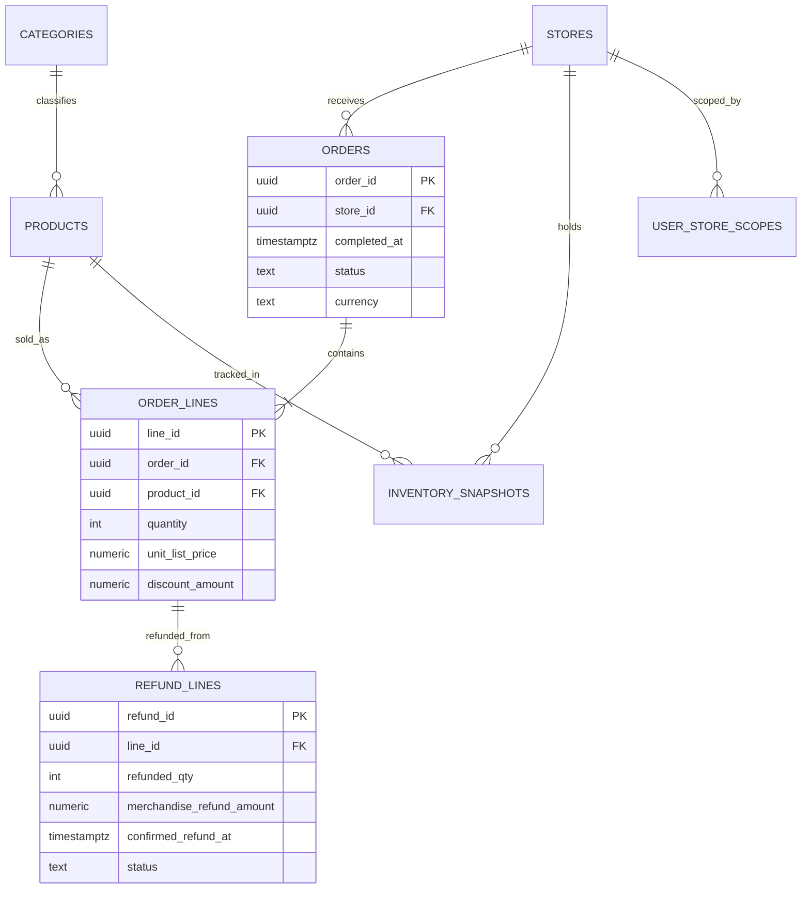

# 03 — Business Metrics & Conceptual Data Design / 业务指标与数据库概念设计

**Version:** 0.1 DRAFT / 草案  
**Status:** PROPOSED, NOT ACCOUNTING-APPROVED / 尚未通过业务/会计审核  
**Design principle:** Database-first AND metric-first: define expected facts and reconciliations before building physical tables. / 指标定义与数据模型同步先行。

## 1. Proposed reporting conventions / 建议报表约定

| Item / 项目 | Proposed convention / 建议规则 | Status |
|---|---|---|
| Company / 企业 | Fictional retailer NovaMart; no real individuals or customers / 虚构企业 | Proposed |
| Currency / 币种 | SGD only, no FX conversion in MVP / 仅新币 | Pending approval |
| Business timezone / 业务时区 | Asia/Singapore / 新加坡时区 | Pending approval |
| Calendar month / 日历月 | Local midnight inclusive to next local month midnight exclusive, `[start,end)` / 左闭右开 | Proposed |
| 'Last month' / 上个月 | Previous complete calendar month at query's local timestamp / 上个完整日历月 | Proposed |
| Gross sales / 销售总额 | Completed merchandise line item full list amount; exclude shipping and tax / 已完成订单商品总价 | Pending accounting approval |
| Discounts / 折扣 | Line-level posted discounts for completed merchandise order lines / 完成订单商品折扣 | Pending approval |
| Refunds / 退款 | Confirmed merchandise refund recorded in month of confirmed refund date / 按确认退款时间冲减 | Pending approval |
| Net merchandise revenue / 商品净收入 | Gross merchandise sales − merchandise discounts − confirmed merchandise refunds, all by recognized event date / 依收入事件时间加减 | Pending approval |
| Cancellations / 取消 | Never booked to completed merchandise sales / 未完成订单不纳入销售额 | Proposed |
| Tax and delivery / 税与运费 | Excluded consistently from all merchandise measures / 商品 KPI 不包含 | Pending approval |
| Data freshness / 数据时间 | Every response shows `data_as_of` or warehouse refresh time / 展示数据快照时间 | Proposed |

**Important:** This is an internally consistent **demo reporting policy**, not a claim about formal GAAP/IFRS recognition. In a real deployment, finance and accounting owners must approve the rules. / 属于演示项目的业务定义，不宣称符合特定会计准则。

### Why order date and refund date differ / 为什么订单与退款分开计期

If a September sale is refunded in October, the September completed-sale metric still records the original sale, while October recognizes the refund. This makes October net merchandise revenue include refund events from earlier orders. / 9 月售出的货物若 10 月退款，9 月销售额保留原记录，退款在 10 月单独冲减，因此 10 月净收入可能包括以前月份订单的退款。

**Never** use the same label `net_revenue` for both event-date net sales and order-cohort net-after-all-returns; they answer different questions. / 禁止混用事件时间净收入与订单同期回溯净额。

## 2. Conceptual entities and grain / 概念实体与粒度

| Entity / 实体 | Grain / 每行含义 | Key relationships / 关系 | Core fields / 关键字段 |
|---|---|---|---|
| `stores` | One store/channel / 一个门店或渠道 | Parent to orders, stock | `store_id`, `name`, `channel`, `status` |
| `categories` | One product category / 一类别 | Parent to products | `category_id`, `category_name` |
| `products` | One SKU / 一个产品 SKU | Category reference | `product_id`, `sku`, `category_id`, `status` |
| `orders` | One order / 一张订单 | Store reference | `order_id`, `store_id`, `completed_at`, `status`, `currency` |
| `order_lines` | One purchased line / 一条订单明细 | Order and product reference | `line_id`, `order_id`, `product_id`, `quantity`, `unit_list_price`, `discount_amount` |
| `refund_lines` | One confirmed line-level refund / 单次行级退款 | Original order line reference | `refund_id`, `line_id`, `refunded_qty`, `merchandise_refund_amount`, `confirmed_refund_at`, `status` |
| `inventory_snapshots` | SKU × store × timestamp / 商品×门店×时点 | Product and store refs | `snapshot_id`, `store_id`, `product_id`, `captured_at`, `on_hand_qty` |
| `user_store_scopes` | Principal × authorized store / 用户×允许门店 | References store + user | `principal_id`, `store_id`, `valid_from`, `valid_to` |
| `metric_catalog` | Metric × definition version / 指标×版本 | Config, not transaction fact | `metric_id`, `version`, `formula`, `allowed_dimensions`, `status` |

`order_lines` is the authoritative grain for merchandise sales. `refund_lines` is the authoritative grain for recognized merchandise refunds. Do not join refunds directly onto sales lines and sum original sales values (one-to-many refunds would duplicate sales). / 订单明细和退款明细应分别聚合，避免一对多关联造成销售额重复。

### Conceptual ERD / 概念 ERD

This is a conceptual diagram; no SQL DDL or database has been implemented. / 这是概念设计，并非已建数据库。

## 3. Controlled event model / 受控收入事件层

Propose an approved analytical view or materialized fact contract `fact_merchandise_events` with **one event per original completed order line or confirmed refund line**: / 建议构建可审核的收入事件事实视图，每行代表一笔完成销售行或确认退款行。

| Field / 字段 | Meaning / 含义 |
|---|---|
| `event_id` | Stable unique key, namespaced by sale/refund type / 稳定唯一事件键 |
| `event_type` | `sale` or `refund` / 销售或退款 |
| `event_at` | `completed_at` for sale, `confirmed_refund_at` for refund / 事件发生日期 |
| `store_id` | Store inherited from original order / 对应门店 |
| `product_id`, `category_id` | Dimensional attribution / 产品与分类 |
| `gross_sales_amount` | Positive list-price amount on sale; zero on refund / 完成销售总价 |
| `discount_amount` | Positive discount amount on sale; zero on refund / 销售折扣 |
| `refund_amount` | Positive confirmed merchandise amount on refund; zero on sale / 确认退款额 |
| `net_revenue_effect` | `gross_sales_amount - discount_amount - refund_amount` / 单行净收入贡献 |

Refund attribution remains tied to the **original product/category and store**; category updates should preserve a documented historical classification policy (e.g. category-at-sale via snapshot). / 退款仍归属原售出门店与产品类别，分类变更需历史版本策略。

## 4. Versioned KPI contracts / 版本化指标契约

### M01 — Gross Merchandise Sales / 商品总销售额

`SUM(gross_sales_amount)` over event dates for completed sales. No refunds, discounts, tax or shipping deducted. / 完成销售的商品标价总和。

### M02 — Booked Merchandise Discount / 商品折扣额

`SUM(discount_amount)` over completed sale events; positive money amount. / 同期完成销售的商品折扣总额。

### M03 — Confirmed Merchandise Refund / 确认商品退款额

`SUM(refund_amount)` over confirmed refund events; positive money amount. / 以确认退款事件日期汇总。

### M04 — Net Merchandise Revenue / 商品净收入

`M01 - M02 - M03` for a reporting period. SGD and event-time basis. Can be negative in extreme refund-dominant periods; do not clamp negative values. / 净收入等于销售总额减折扣减退款，允许极端情况下为负。

### M05 — Completed Order Count / 完成订单数

`COUNT(DISTINCT order_id)` for orders with `status=completed` and `completed_at` inside period, scoped to authorized stores. Order cancellations excluded. / 期间内完成的订单去重计数。

### M06 — Sold Units / 完成销售数量

`SUM(quantity)` of completed order lines within period; refunds do **not** reduce this separate metric (optional `net_units` would require an independent definition). / 完成订单商品数量，不自动扣退货数量。

### M07 — Average Order Value (AOV) / 平均订单商品销售金额

`(M01 - M02) / M05` for the same completed-order period, when `M05>0`. **AOV excludes later recognized refunds**, unlike M04. Label UI clearly as `AOV (sales after discounts, before refunds)`. / AOV 按完成订单、折扣后未扣退款的商品金额除订单数，与事件净收入不能混为一谈。

### M08 — Period Growth % / 期间增长率

`(current_value - previous_value) / abs(previous_value) × 100%` is **not** universally meaningful for negative previous values; for financial growth show standard `(current - previous)/previous × 100%` only if previous > 0, otherwise show `N/A` with absolute Δ. / 仅当基期正值时呈现标准增长率，否则展示绝对变化及不适用说明。

### M09 — Revenue Contribution by Category / 类别净收入变化贡献

For each category `c`, `delta_c = M04(c,current) - M04(c,previous)`. Total `delta_total = M04(all,current) - M04(all,previous)`. Require `SUM(delta_c) = delta_total` (within final currency rounding tolerance). Positive categories offset negative ones. A decline contribution percentage may exceed 100% if other categories offset the decline; avoid misleading percentages by showing signed SGD deltas first. / 各类别的净收入变化之和必须与全公司变化一致，优先展示金额而非误导性百分比。

### M10 — Low Stock (P1) / 低库存（P1）

Latest eligible inventory snapshot per `(store,product)` and `on_hand_qty < configured_reorder_threshold`. Display snapshot timestamp and exclude stale data; threshold must be explicitly configured and not invented by LLM. / 基于最新合格快照和预先定义阈值，严禁 AI 乱猜低库存标准。

## 5. Critical metric tests / 关键指标验证样例

**Example A — simple reconciliation / 简单对账（虚构测试）**

- Completed line: 2 units × SGD 50 = SGD 100 gross; SGD 10 line discount; recognized on 2026-09-05.
- Confirmed refund: SGD 45 for one unit on 2026-10-03.
- September M01 = 100; M02 = 10; M03 = 0; **M04 = 90**. September M05=1; **AOV=90**.
- October M01=0; M02=0; M03=45; **M04 = −45** (same original category/store), October M05=0 so **AOV=N/A**.

This deliberately tests refund recognition, negatives and zero denominator. / 用来测试退款跨月、负净收入、零分母。

**Example B — decline diagnosis / 收入下降诊断（虚构测试）**

| Category | September | October | Delta |
|---|---:|---:|---:|
| Electronics | 50,000 | 35,000 | -15,000 |
| Clothing | 40,000 | 32,000 | -8,000 |
| Home | 30,000 | 33,000 | +3,000 |
| **Total** | **120,000** | **100,000** | **-20,000** |

Expected: Total delta -20,000; month-over-month change -16.666…% displayed as -16.7%; categories reconcile (-15,000 - 8,000 + 3,000 = -20,000). **Do not claim** electronics demand declined due to competitors, holidays or store closures without evidence. / 类别可对账，不能凭空解释消费者原因。

## 6. Data quality constraints / 数据质量规则

- Primary and foreign keys must be present; no orphan order lines/refunds. / 主外键完整。
- Nonnegative prices/discounts/refund amounts; quantities strictly positive for completed sale lines. / 价格与数量约束。
- Per line `0 ≤ discount_amount ≤ quantity × unit_list_price`. / 折扣不得超过售价。
- Cumulative confirmed refund per original line ≤ discounted merchandise line value; cumulative refunded qty ≤ sold qty. / 不得超额退款。
- Events have explicit UTC timestamps stored as `timestamptz`; interpret reporting dates in Asia/Singapore. / 时间戳存 UTC，报告按新加坡时区。
- Completed orders have non-null `completed_at`; canceled orders excluded; event deduplication guaranteed by source key. / 状态与时间一致。
- Stable product/category classification for historical comparisons and returns. / 历史分类一致。
- One currency SGD in MVP; if another currency appears, reject until FX policy exists. / 单币种限制。
- Reconcile store/category/product total against all-store aggregate after authorization scope filtering. / 聚合对账。

## 7. Synthetic dataset / 虚构零售数据计划

**Target size / 目标规模 (not generated):** 5 physical stores + 1 online channel, ~1,000 SKUs in 8–12 categories, 12–24 months and 50k–100k orders. Seeded generation for deterministic reruns. / 建议 5 店加电商、千种 SKU、1–2 年订单，可重复生成。

Include explicit scenario families: price changes, volume dips, higher discounts, confirmed refunds, seasonal promotions, category mix shifts, new products, missing periods, zero prior revenue, stale stock data and unauthorized store requests. / 数据应涵盖折扣、退货、季节性、缺失月份、新品以及权限场景。

**Avoid leakage:** If test scenarios inject a deliberate decline, the AI should only see allowed schema/metrics/data at runtime, not hidden ground-truth scenario labels. / 不能将测试标签泄漏给模型。

## 8. Conceptual approval gates / 数据设计批准门槛

- [ ] Owner approves currency, timezone, calendar and gross-to-net conventions.
- [ ] Owner approves status/refund recognition policy and AOV wording.
- [ ] Metric dictionary versioning contract approved.
- [ ] Original-sale vs refund event grain documented with no double-count joins.
- [ ] Entity relationships, store scopes and dataset generation plan reviewed.
- [ ] Golden reconciliation examples accepted as specification tests.

**Current status / 当前状态: ALL PENDING APPROVAL.**