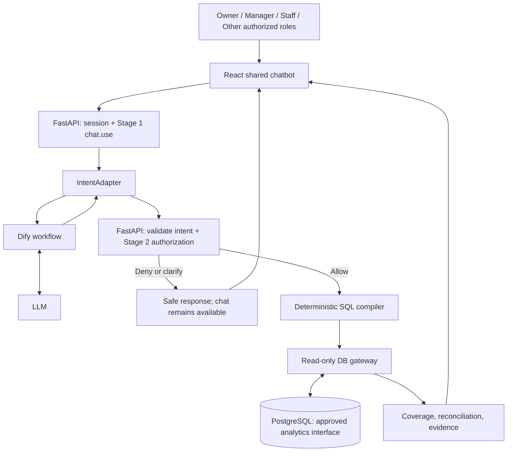
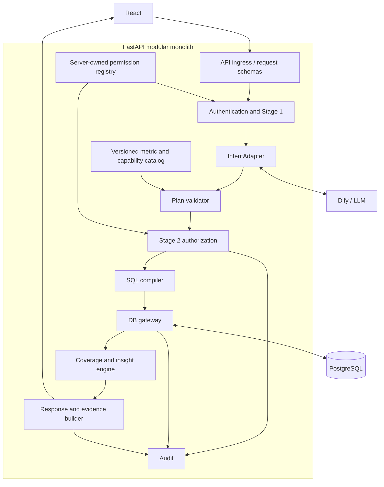
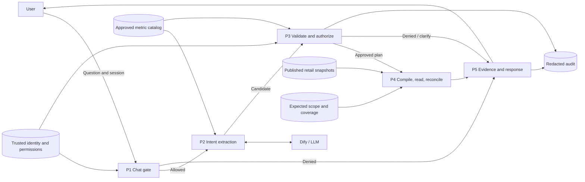
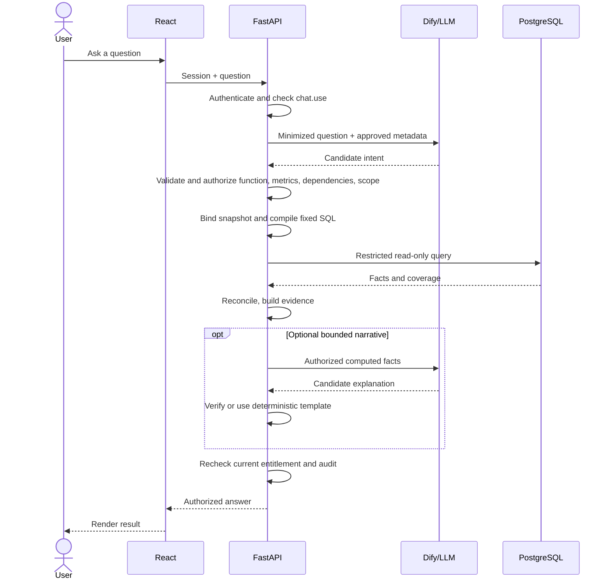
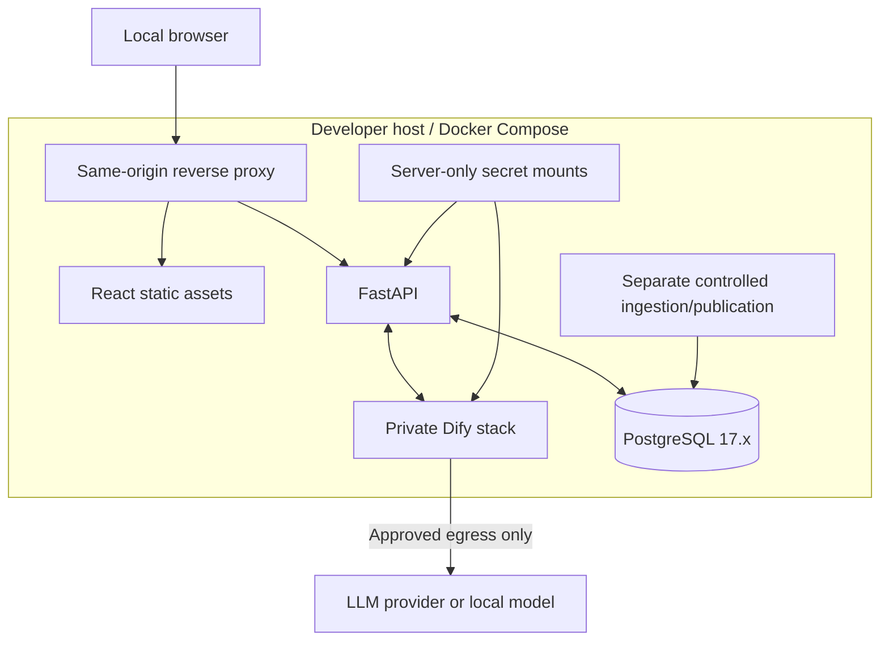

# QueryPilot AI — System Architecture & Security Design v1.1

> **FOR APPROVAL — DEVELOPMENT NO-GO.** Design and review only. No implementation, DDL, deployment or test execution is authorized by this document.

| Document control | Value |
|---|---|
| ID | QP-SA-SSD-001 |
| Revision | 1.1, 26 November 2026 |
| Owner | Solution Architect / Security Architect |
| Reviewers | BA, Data Architect, Backend/AI Lead, QA/Security, Project Owner |
| Baselines | QP-BA-BMD-001 v1.0; QP-DE-DM-001 v1.0 (QP-APR-003); QP-DE-PD-001 v1.0 |
| Status | Pending architecture approval; OD-01–OD-07 open |

This is the English GitHub edition of the v1.1 bilingual review document. Upstream approval is based on the Project Owner's statement; historical approval labels are not rewritten.

## 0. Executive decision brief

Recommend a **modular monolith**, not microservices: one FastAPI application with internal modules and a replaceable IntentAdapter. Dify is a proposed workflow adapter behind the API, not a trust authority. Authorized owners, managers and staff share one chatbot. FastAPI checks chat access before AI interpretation and function, metric, dependency and data-scope permissions afterward. This minimizes operational complexity while demonstrating end-to-end data/AI engineering.

**Review priorities:** architecture (§2–5), API and authorization (§6–8), AI security (§9), tests (§12), open decisions (§13), approval (§14–15), multi-role policy (§17).

## 1. Scope and quality attributes

- Preserve M01–M09 and MR-01–MR-10, NovaMart synthetic retail, SGD merchandise-only, Asia/Singapore half-open date ranges, completed-sale and confirmed-refund event dates.
- Preserve retail, ingest, governance and analytics schemas, stable identities, immutable revisions, atomic publication, snapshot-bound analytics and coverage checks.
- In scope: shared chatbot, bounded query planning, secure execution, evidence, security and deployment design.
- Out of scope: inventory M10, profit/cost, HR, marketing, tax, shipping, PII, unrestricted SQL, autonomous DB agents, production SLA and certification.
- Proposed targets, not measured: SGD 0.00 reconciliation difference, zero unauthorized disclosures, reproducible fixed-snapshot results; 5-second DB statement timeout, 1,000 output rows, 36 calendar months, pool size 10; monthly KPI p95 below 2 seconds on declared local hardware with 120,000 orders.

## 2. Overall architecture and trust boundaries



| Boundary | Allowed | Forbidden |
|---|---|---|
| Browser to FastAPI | Authenticated question, typed filters | Trusted client role/scope assertions, raw SQL |
| FastAPI to Dify | Minimized question, generic approved metadata | DB credentials, full schema, raw PII, unrestricted tools |
| Dify to FastAPI | Bounded untrusted intent JSON | Permission grants, SQL, arbitrary URLs |
| FastAPI to PostgreSQL | Reviewed parameterized queries, trusted scope, snapshot | Arbitrary SELECT, DDL/DML, unapproved functions |
| FastAPI to React | Authorized results and evidence | Raw DB errors, secrets, unauthorized values |

## 3. Component architecture



React renders charts, coverage states and evidence, without Dify credentials. FastAPI owns session validation, policy, orchestration, deterministic compilation and response verification. The IntentAdapter is replaceable; Dify never authorizes access. The catalog is versioned and separate from permissions. The gateway uses restricted DB credentials. BA owns metric policy; Data Architect owns the analytical interface; Security reviews boundaries; Backend/AI engineers implement only after GO; QA verifies negative and golden tests; Project Owner records decisions.

## 4. Data flow and lifecycle



At a fixed snapshot, one SALE per eligible completed line, one REFUND per confirmed refund line and one REVERSAL per posted adjustment are combined without sale/refund fan-out. Original category and store attribution is retained. Net revenue effect = gross sales minus discounts minus signed refunds. Coverage is checked independently. Ingestion/publication is a separate trusted process, never initiated by chat. Revalidate every follow-up and evidence retrieval.

## 5. Sequence diagrams

### Authorized request



### Denied request with chat still enabled

```mermaid
sequenceDiagram
    actor U as Sales Staff
    participant R as React
    participant F as FastAPI
    participant D as Dify/LLM
    U->>R: What is our revenue this month?
    R->>F: Authenticated question
    F->>F: Stage 1 chat.use granted
    F->>D: Question + minimized metadata
    D-->>F: Candidate M04
    F->>F: Stage 2: M04 not granted
    F-->>R: 403 FORBIDDEN_QUERY
    R-->>U: Safe denial; chat remains available
    Note over F: No business SQL compiled or executed
    U->>R: How many units did we sell?
    R->>F: New question; repeat all checks
```

No chat permission: reject before AI without interpreting the question. Unsupported profit/inventory: 422 before SQL, even for Owner. Ambiguity: clarify. Incomplete coverage: follow OD-03/07. Diagnostic decomposition requires grants for the requested/exposed metrics and policy-required dependencies.

## 6. FastAPI and API contract

| Method | Endpoint | Policy |
|---|---|---|
| GET | /api/v1/me | Authenticated own effective grants summary |
| GET | /api/v1/catalog | Session + chat.use; permission-filtered enabled capabilities |
| POST | /api/v1/analyses | Session + CSRF + chat.use; post-intent checks |
| GET | /internal/health/live | Internal only; no secrets or business data |
| GET | /internal/health/ready | Internal only; sanitized readiness |

Analysis request: question (1–1,000 characters), locale (en/zh; English primary, Chinese subject to evaluation), optional integer store IDs and ISO local date pair. Client cannot supply trusted request ID, principal, role, permissions, authorized scope or snapshot ID. Explicit ungranted store IDs reject; omitted scope uses server grants.

Response: request_id, status, intent, metric_ids, exact SGD decimal-string values, dimensions, date_range_sgt, comparison, coverage, snapshot_id, metric_version, model_workflow_version, evidence, narrative and warnings. Record policy_version. Never return raw SQL or unauthorized fields. COMPLETE_ZERO requires verified coverage; INCOMPLETE/UNKNOWN are not zero; N_A for invalid denominators; PARTIAL disabled pending policy.

| HTTP | Code / behavior |
|---|---|
| 400 | BAD_REQUEST — malformed/disallowed input |
| 401 | UNAUTHENTICATED — login required |
| 403 | FORBIDDEN_CHAT / FORBIDDEN_QUERY / FORBIDDEN_SCOPE — safe denial |
| 409 | SNAPSHOT_NOT_READY — compatible snapshot/policy unavailable |
| 422 | UNSUPPORTED_QUERY — unsupported, invalid or ambiguous intent; clarify safely |
| 429 | RATE_LIMITED — retry-after; no model/query execution |
| 503 | UPSTREAM_UNAVAILABLE — no fabricated answer; explicit catalog-query fallback only |
| 504 | EXECUTION_TIMEOUT — bounded deadline, audited |

Metric invariants: M05 distinct completed orders, non-additive across categories; M07=(M01−M02)/M05 before refunds, N/A if zero orders; M08 growth N/A when prior ≤0; M09 category deltas reconcile to total M04 delta including Unassigned.

## 7. Authentication and authorization

Proposed OIDC Authorization Code + PKCE, same-origin backend-for-frontend (BFF), server-held tokens, opaque HttpOnly Secure SameSite session cookie; validate signature, issuer, audience, expiry and applicable nonce/state. CSRF protection, TLS, strict origin/CORS policy. Local test-identity fixture is DEMO only, offline, not production identity assurance. IdP and persistence require approval.

| Role | Proposed grants (not approved matrix) |
|---|---|
| Business Owner | chat.use; assigned M01–M09, diagnose and explicitly granted stores |
| Store Manager | chat.use; assigned metrics/functions and stores |
| Sales Staff | chat.use; M06 in assigned stores; no finance or diagnose by default |
| Inventory Staff | chat.use if assigned; optional M06; inventory disabled |
| Data Analyst | chat.use; explicit metric/function/store grants |
| System Admin | users.manage separately; chat only if assigned; no implicit finance |
| Service identities | Separate analytics and publisher privileges |

Permission registry: chat.use; analytics.kpi/rank/compare/diagnose; metric.M01.read through metric.M09.read; users.manage. Roles map to explicit grants, scope and current policy. Default deny. No automatic all-store access even for Owner. Stage 1 checks chat entitlement; Stage 2 checks enabled function, metric, dependencies and store subset. Never trust caller or model authority claims.

Database: qp_analytics is a restricted non-owner, non-BYPASSRLS login with approved interface execution only, no direct retail/ingest/governance base access or writes. Revoke unnecessary PUBLIC grants; schema-qualify objects, fixed search_path, no dynamic SQL. Shared login alone does not provide per-user DB identity. Independent nonforgeable scope binding and negative tests are a blocker; per-principal identity/RLS is an option requiring security ADR and compatibility review. Review SECURITY DEFINER ownership, security_invoker and RLS bypass by owners/superusers/BYPASSRLS.

## 8. Controlled SQL execution

Five gates: G1 identity/chat entitlement; G2 strict JSON plan schema; G3 semantic allowlist and fine-grained authorization (including OD-06); G4 finite reviewed SQL templates with developer-mapped identifiers and bound values; G5 restricted read-only transaction, timeout, row/date/concurrency limits, cancellation and audit. No model-generated SQL reaches execution.

| Intent | Permitted shape |
|---|---|
| kpi | M01–M07; authorized scope and compatible snapshot |
| rank | Approved store/category dimensions; stable tie-break and bounded limit |
| compare | M08 like-for-like periods and identical scope |
| diagnose | Fixed M04 decomposition using M01–M03 and approved M09 contribution outputs |

Physical interface: analytics.merchandise_events(snapshot_id, authorized_scope, start_at, end_at). It is not a public endpoint; trusted scope binding and privilege arrangement require sign-off. Provide template ID/hash, bounded authorized provenance, snapshot, coverage, metric/policy version. Do not return raw SQL. Quarantine unresolved corrections.

## 9. Dify and LLM security

IntentAdapter.extract(question, approved_metadata, locale, minimal_context) returns an untrusted IntentCandidate. FastAPI initiates workflow requests only after Stage 1. No database credentials, unrestricted tools, arbitrary callbacks or direct DB connection. Send generic approved metadata and minimum necessary text, not user-specific grants or raw rows. Optional narrative receives only authorized computed facts, dates, coverage and evidence labels. Review provider retention, egress and licensing before use.

Prompt-injection controls: treat questions, history, labels and model output as untrusted data; separate system instructions and data; use strict bounded schema with extra fields rejected; reject SQL, tools and URL fields; no privilege delegation; validate semantics and authorization independently; restrict egress and plugins; cap tokens, retries and deadlines. Model output cannot change metric definitions or permissions. Use deterministic narrative by default or verify candidate claims against evidence and fall back if invalid; never infer external causes from numerical contributions alone. Record workflow/model version and sanitized run metadata. Do not silently swap to another metric on ambiguity.

## 10. Threat model

STRIDE-inspired qualitative design priorities; not measured findings.

| ID | Risk | Control |
|---|---|---|
| T01 | Critical: cross-store BOLA | Trusted scope and negative tests |
| T02 | Critical: prompt injection into execution | No model tools/SQL authority; strict schema and compiler |
| T03 | High: SQL injection | Bound values, mapped identifiers |
| T04 | High: shared DB interface scope spoofing | Independent scope-binding review |
| T05 | High: incomplete-feed misinformation | Coverage gate, OD-03/07 |
| T06 | High: snapshot drift/history leakage | Pin snapshot, version and provenance |
| T07 | High: key leakage/SSRF | Server-held keys, egress allowlist, no arbitrary tools |
| T08 | High: session hijack/CSRF/CORS | OIDC, secure cookies, TLS, origin controls |
| T09 | High: cost/availability exhaustion | Rate, token, timeout and row caps |
| T10 | High: malicious dependencies | Pin versions/digests, SBOM and scans |
| T11 | Medium: XSS | Escape text, sanitize Markdown, CSP |
| T12 | High: sensitive logs/prompts | Redaction, egress audit, retention review |
| T13 | High: privileged function/RLS bypass | Least privilege, fixed search_path, role tests |
| T14 | Medium: hallucination/causal overreach | Deterministic facts and evidence checks |
| T15 | High: catalog tampering | Versioned review-controlled catalog |
| T16 | Critical: cross-role or derived-value leakage | Stage 2 dependency/output authorization |
| T17 | High: stale grants, role escalation, chat/cache leakage | Revalidate each turn and response; audit changes; isolated/no cache |

No claim of commercial tenant isolation, production readiness or regulatory compliance.

## 11. Deployment, networks and secrets



Local-first, private API/DB/Dify networks; no public database or Dify admin port. Dify may require additional internal services. Remote demo requires TLS, authenticated access, private administration and egress review; no cloud provider selected. Keep keys out of Git, frontend, browser storage and logs. Separate qp_owner (NOLOGIN), qp_migrator, qp_ingest, qp_publisher (NOLOGIN), qp_analytics and qp_auditor per physical design. Test backup restores separately and preserve history. Pin dependencies, maintained PostgreSQL patch and images after approval; review license and vulnerabilities.

Dify self-host is preferred candidate for workflow visibility and portfolio value, but costs include hardware/model resources and license obligations. Direct LLM adapter has fewer services but more custom orchestration; API costs possible. ADR-SA-07 remains pending.

## 12. Security test plan

All tests are specified, not executed.

| ID | Test | Acceptance |
|---|---|---|
| ST-01 | Endpoint authentication matrix | Expected 401/403; zero unauthorized queries |
| ST-02 | Disjoint store principals | No cross-store totals, labels, provenance or cache |
| ST-03 | Direct/indirect prompt injection | No secrets, widened grants or unauthorized tools/SQL |
| ST-04 | SQLi and unexpected plans | Unsupported plans rejected before compiler |
| ST-05 | DB grants and RLS/interface | No base table or write access; forged scope rejected |
| ST-06 | Golden M01–M09 / RR-01–12 | Exact SGD 0.00 reconciliation |
| ST-07 | Coverage and OD gates | Missing never becomes zero |
| ST-08 | Late refund snapshot | Old snapshot reproducible; new restatement disclosed |
| ST-09 | Boundaries and integrity | SGT month boundaries and refund/discount caps |
| ST-10 | Limits/DoS | Proposed 5s/1,000 rows/36 months/pool 10 enforced |
| ST-11 | Secrets, CSRF, CORS, XSS, logs | No credential/PII leakage |
| ST-12 | Dependencies and licenses | No unaccepted critical findings; license reviewed |
| ST-13 | Evidence and ambiguity | No invented numbers or unsupported causal claims |
| ST-14 | Backup/recovery | Restored hashes and totals match |
| ST-15 | Stage 1 denial; staff M04 vs M06 | No AI when chat denied; no SQL for denied M04 |
| ST-16 | Same question across roles; derived metrics | No unauthorized output or missing-dependency diagnostic |
| ST-17 | Disabled capability or injected/ambiguous intent | Reject/clarify; zero SQL; no silent substitution |
| ST-18 | Revocation, follow-up, chat/cache isolation | Recheck every turn and response; no stale/cross-user disclosure |

Proposed tools after GO: pytest, FastAPI TestClient/httpx, Hypothesis, PostgreSQL integration tests, Playwright, OWASP ZAP, Semgrep/Bandit, pip-audit, npm audit, Gitleaks, Trivy. Use approved synthetic core (120k orders, 300k lines), independent golden fixtures, invalid staging and temporal cases. No accuracy, latency or security pass rates claimed.

## 13. Open decision dependencies

All remain OPEN and BLOCKING pending written disposition; proposed containment does not close them.

| ID | Outstanding decision | Containment | Owner |
|---|---|---|---|
| OD-01 | Completed-order non-refund correction | Quarantine; no silent overwrite; block dependent analysis | BA / PO |
| OD-02 | Discount cap/allocation exception | Reject affected publication; preserve M02 | BA / PO |
| OD-03 | Provisional/final coverage criteria | Expected feeds, totals and verified watermarks; UNKNOWN pending policy | BA / Data Architect |
| OD-04 | Reversal quantity restoration | No restoration without policy; retain signed refund model | BA / PO |
| OD-05 | Version storage/FK implementation | Preserve approved stable-ID/immutable-revision contract; confirm realization | Data Architect / PO |
| OD-06 | Dimension allowlist and M05/M07 matrix | Deny unapproved slices; distinct order count; restrict AOV | BA / PO |
| OD-07 | Freshness and restatement disclosure | Daily 06:00 SGT proposed only; flag stale/missing; show as-of | PM / BA / PO |

Separate development GO requires approved architecture, explicit OD dispositions, approved security boundary and readiness criteria. Execution of implementation tests occurs only under a separate authorization; release requires passing evidence.

## 14. Architecture decision records

| ADR | Proposed decision | Status |
|---|---|---|
| ADR-SA-01 | Modular FastAPI monolith; React evidence-first UI | Pending |
| ADR-SA-02 | Backend is trusted authorization/execution boundary | Pending |
| ADR-SA-03 | Deterministic allowlisted compiler | Pending |
| ADR-SA-04 | Snapshot/coverage evidence and exact SGD | Pending |
| ADR-SA-05 | OIDC/BFF; local demo fixture; scope registry | Pending |
| ADR-SA-06 | Execute-only analytics interface; nonforgeable scope | Pending |
| ADR-SA-07 | Dify candidate behind replaceable adapter | Pending |
| ADR-SA-08 | Private local Docker Compose | Pending |
| ADR-SA-09 | Evidence-grounded narrative and locale evaluation | Pending |
| ADR-SA-10 | Separate GO, DDL, security and license gates | Pending |
| ADR-SA-11 | Shared chatbot and two-stage fine-grained authorization | Pending |

Reject autonomous SQL agents, premature microservices, Kubernetes and vector databases for the bounded MVP. Cloud hosting deferred.

## 15. Approval checklist

- [ ] Review diagrams, component responsibilities and trust boundaries.
- [ ] Accept API and response/error contracts.
- [ ] Approve identity, two-stage permissions, dependency matrix, registry and DB enforcement.
- [ ] Independently review compiler and privileged interface.
- [ ] Approve Dify/model, egress, keys and license strategy.
- [ ] Accept threat model and negative test requirements.
- [ ] Record OD-01–07 dispositions or explicit blockers.
- [ ] Assign backup, observability and retention ownership.
- [ ] Confirm business and physical baselines unchanged.
- [ ] Require separate written Development GO.

Decision: Approved / Approved with conditions / Changes required / Rejected or deferred.

Architect, Security Reviewer, BA/Data Architect, Project Owner: pending signatures, dates and decision reference.

## 16. Sources and change control

Internal baselines: QP-BA-BMD-001, QP-DE-DM-001, QP-DE-PD-001, [Phase 1 proposed architecture](04_ARCHITECTURE_SECURITY_ADRS.md), Project Owner multi-role requirement dated 26 November 2026.

Technical references retained from review document:
- [Dify Workflow API](https://docs.dify.ai/en/api-reference/guides/workflow)
- [Dify API guide](https://docs.dify.ai/en/api-reference/guides/get-started)
- [PostgreSQL 17 row security](https://www.postgresql.org/docs/17/ddl-rowsecurity.html)
- [FastAPI security](https://fastapi.tiangolo.com/tutorial/security/oauth2-jwt/)
- [OWASP LLM01 Prompt Injection](https://genai.owasp.org/llmrisk/llm01-prompt-injection/)
- [OWASP API Security Top 10](https://api-security.owasp.org/editions/2023/en/0x11-t10/)
- [Dify license](https://github.com/langgenius/dify/blob/main/LICENSE) — verify exact revision before shipping.

Changes to approved metrics, data grain, keys, historical versions or snapshot arithmetic require formal change request and upstream re-approval. Proposed architecture changes require ADR amendment and revision.

## 17. Multi-role security supplement

Every turn, follow-up, evidence retrieval and future export must use current authenticated principal and policy. Re-resolve entitlements before returning results; abort if policy version changes. History does not grant permission. No shared answer cache or persistent chat history in proposed MVP until isolation review.

Separate security registry proposal: principal_ref, role assignments, permission definitions, role-permission mapping, principal/store scope and entitlement_version; audit grant/revoke. IdP identity verified; registry server-owned; no Dify write rights. Exact persistence and DB scope-binding design require separate approval and do not alter retail schema.

**Dependency policy:** M04 requires its own grant; approved internal M01–M03 inputs may calculate M04 without exposing those inputs. Decomposition outputs require separate M01/M02/M03 grants. M07–M09 derived access requires reviewed policy. Deny unauthorized compound requests; default deny composite queries until dependency matrix signed.

Candidate contract: status candidate / unsupported / clarify; candidate intent kpi / rank / compare / diagnose; approved metric_ids; typed bounded period, dimensions, filters, sort and limit. FastAPI maps capability; no model-supplied principal, grants, SQL or callable URL. Future capability requires registered ID, typed contract, permission, data boundary, handler and negative tests before enablement.

A user with chat.use but no analytics grant can still receive a safe denial/unsupported response; no business query. Suggestions must use permission-filtered catalog. Do not reveal restricted metric details through errors. A denied query does not revoke chat permission. Re-authorize "What about all stores?" and invalidate stale answers when permissions change.

### Revision history

- v1.0 (24 Nov 2026): initial architecture review candidate.
- v1.1 (26 Nov 2026): shared chatbot, two-stage authorization, registry, role proposals, revised diagrams/API, T16–T17, ST-15–ST-18, ADR-SA-11. Existing business/data baselines and OD-01–07 unchanged.

**Final status: pending v1.1 architecture approval. Development NO-GO.**
