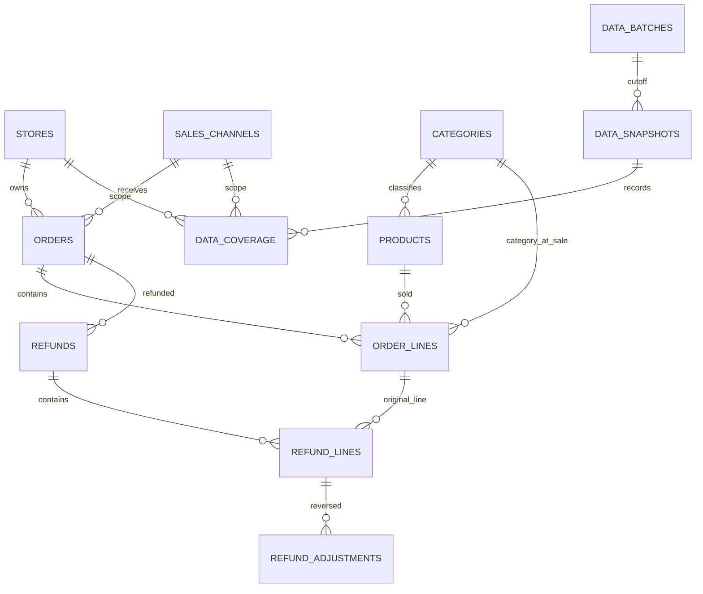

# Conceptual ERD & Data Model v1.0 / 概念及逻辑数据模型

Document QP-DE-DM-001 | Database Engineer / Data Architect | Approved design baseline: [QP-APR-003](16_DATABASE_DESIGN_APPROVAL_RECORD.md). This is a GitHub-readable technical summary of the approved Word candidate, not a replacement for its complete field dictionary or diagrams. Development NO-GO.

## Scope and design / 范围与设计
NovaMart fictional retail, SGD, Asia/Singapore. Normalized transaction model plus governed analytical semantic layer. Exclude PII, inventory, costs/profit, tax, shipping, forecasting and causal inference. Use event-date revenue, immutable historical attribution and exact amounts.

## Conceptual ERD

## Logical entities, fields and grain / 逻辑实体与粒度
All identity PKs non-null and unique; mandatory FKs except explicit nullable cases. B=BIGINT, I=INTEGER, M=NUMERIC(18,2), T=TIMESTAMPTZ, D=DATE. Strings use bounded VARCHAR or TEXT. Stable identity differs from revision identity.

| Entity | Grain | Key attributes |
|---|---|---|
| stores | operating unit | store_id PK, store_code UQ, store_name, region, opened_on D, closed_on D nullable, status |
| sales_channels | channel | channel_id PK, channel_code UQ, channel_name, status |
| categories | stable category | category_id PK, category_code UQ, category_name, description nullable, status |
| products | SKU | product_id PK, category_id FK, sku UQ, product_name, current_list_price M, status, created_at T |
| orders | order | order_id PK, order_number UQ, store_id FK, channel_id FK, status, ordered_at T, completed_at/cancelled_at T conditional, currency_code SGD, header_discount M, source_net_total M conditional |
| order_lines | merchandise line | line_id PK, order_id FK, line_number, product_id FK, category_at_sale_id FK, quantity I, unit_list_price M, line_discount M, header_discount_allocated M; UQ(order_id,line_number) |
| refunds | refund transaction | refund_id PK, refund_number UQ, order_id FK, requested_at T, confirmed_at T conditional, status, reason_code nullable, source_merchandise_total M conditional |
| refund_lines | refund × original sale line | refund_line_id PK, refund_id FK, original_line_id FK, refund_quantity I, refund_amount M, refund_kind; UQ(refund_id,original_line_id) |
| refund_adjustments | posted reversal | adjustment_id PK, adjustment_number UQ, refund_line_id FK, adjustment_at T, signed_amount M negative, reason |
| data_batches | ingestion batch | batch_id PK, batch_code UQ, source_name, source_version, ingested_at, published_at conditional, publish_sequence UQ when published, status, source_checksum |
| data_snapshots | as-of snapshot | snapshot_id PK, max_publish_sequence FK, snapshot_at, metric_version, data_model_version, supersedes_snapshot_id nullable FK, restatement_reason conditional |
| data_coverage | snapshot × date × store × channel × feed | coverage_id PK (logical), snapshot_id/store_id/channel_id FK, business_date, feed_type, coverage_status, finality_status, source_watermark nullable, reason conditional; composite UQ |

Each parent can have zero to many children; completed orders and confirmed refunds must have at least one line. Refund header and original sale line must belong to the same order. Maintain source_system, source_record_key, batch_id, revision_number and recorded_at as appropriate; select latest eligible revision before joins. Published history is immutable; late arrivals produce new snapshots. Preserve original price, store/channel and category-at-sale; UNASSIGNED preserves uncategorized revenue.

## Analytical contract and metric mapping
Canonical fact_merchandise_events: one row per eligible SALE, REFUND or REFUND_REVERSAL with typed event_id, event_at, business_date, original order/line/store/channel/product/category, gross_sales_amount, discount_amount, signed_refund_amount, sold_quantity, net_revenue_effect, source lineage and snapshot. Select versions, deduplicate, UNION ALL, authorize scope before aggregation. Refund/reversal branches have zero sales and units. No sales-to-refunds fan-out: sale 100 plus refunds 20 and 10 yields 70, not 170.

| Metric | Definition |
|---|---|
| M01 | SUM completed quantity × historical list price |
| M02 | SUM line discount + allocated header discount |
| M03 | SUM signed confirmed refunds, including negative reversals |
| M04 | M01 − M02 − M03 |
| M05 | COUNT DISTINCT completed order IDs from sales only |
| M06 | SUM sold quantities, not net returned units |
| M07 | (M01 − M02)/M05, N/A when no orders |
| M08 | Current − prior; growth % only when prior > 0 |
| M09 | Category-at-sale current net revenue − prior net revenue |

SGT half-open period; sale uses completion, refund confirmation, reversal adjustment date. Exact cents, round only for display. Category/product order counts non-additive; AOV restricted pending BA. Missing/partial coverage is not zero; complete empty additive results can be zero.

## Integrity and reconciliation
DI-01–22: unique PK, valid FK, unique business numbers, restrict deletion, idempotency, completed lines required, positive quantity, nonnegative price/discount, line discount cap, exact header allocation, cumulative refund cap, reversal cap, same-order refund association, SGD exact money, ordered ≤ completed, completed ≤ refund request, request ≤ confirmation, confirmation ≤ adjustment, immutable historical attribution, no overwrite of published revisions, distinguish missing from zero, reject unvalidated publication. Cross-row constraints require concurrency-safe transactions.
RR-01–12: line gross, line net, header discount allocation, independent order source total, independent refund source total, reversal balance, sale refund cap, event uniqueness/completeness, store/category/day rollups, category change sum. Exact tolerance SGD 0.00. Allocate header discount proportionally by eligible gross using largest remainder in cents and stable line_id tie-break. Reject cap violations pending BA rule.

## Synthetic design and acceptance
Jan 2024–Oct 2026; 5 physical stores plus online unit; POS/WEB; 500 SKUs (Electronics 125, Home & Living 100, Fashion 100, Beauty 75, Groceries 100), reserved UNASSIGNED. Target 120k orders, 300k lines, 8k refunds, 10k refund lines, 300 reversals. Fixed seed, uneven store/product demand, seasonal patterns, discounts, cross-month refunds, historical changes, late/missing data. Separate valid core, golden, invalid, temporal datasets. No generated records yet.

Golden example: September gross 300 discount 30 net 270; October gross 150 discount 15 refunds 75 net 60; November isolated reversal −45 refund yields net 45. Orders 2/1/0; AOV 135/135/N/A. Fixtures are expected values, not executed query results.

AT-01–26 cover normal/pending/cancelled sales, distinct orders, fan-out, cross-month and partial refund, excessive refund, reversal, idempotency, historical price/category, UNASSIGNED, rounding, zero denominator, negative prior, authorization, complete zero/missing, late data, category rollup, cross-order refund, midnight, refund-only periods, concurrent refund and non-refund corrections. Tests not executed.

## Design approval and security
ADR-D01–12 accept normalized model, separate order and refund headers/lines, append-only reversals, historical attributes, exact money, snapshots/coverage, typed events, synthetic volume and separate test sets, no PII/inventory/cost, separate implementation gate. Read-only controlled analytics; no direct LLM credentials; approved metrics/dimensions, authorization before aggregation, evidence lineage. See physical design and architecture approval. OD-01–07 and independent BA validation remain open. No implementation authorized.
