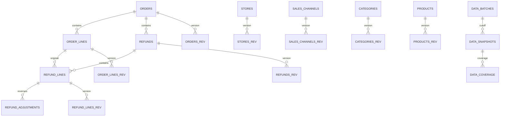

# Physical Database Design & Data Specification v1.0
物理数据库设计与数据规范 | QP-DE-PD-001 | [Approval QP-APR-004](16_DATABASE_DESIGN_APPROVAL_RECORD.md)

GitHub technical summary of the approved Word review candidate. Design approved subject to conditions; development NO-GO. PostgreSQL 17.x proposed, subject to architecture compatibility and validation.

## Physical schemas / 模式
| Schema | Responsibility |
|---|---|
| ingest | staging and rejected records, validation |
| retail | nine business identities, eight revision tables |
| governance | batch publication, snapshots, expected scope and coverage |
| analytics | fixed governed merchandise event and metric interfaces |

## Physical identity and revision structure

Core logical fields are in [14](14_CONCEPTUAL_ERD_DATA_MODEL_V1_0.md). Stable business identity PK BIGINT GENERATED ALWAYS AS IDENTITY; source_system VARCHAR(50), source_record_key VARCHAR(120), first_batch_id FK; UQ(source_system,source_record_key) within each identity table. Refund adjustment is immutable with batch_id instead of first_batch_id. Keep stable identity relationship keys; enforce refund line belongs to same order using composite FK. No cascading deletes.

Each of the eight revision tables (stores, sales_channels, categories, products, orders, order_lines, refunds, refund_lines) has entity_id FK, revision_number INTEGER > 0, batch_id FK, recorded_at TIMESTAMPTZ, source_revision_key VARCHAR(120); PK(entity_id,revision_number), UQ(entity_id,batch_id), UQ(entity_id,source_revision_key). One final revision per entity per published batch. Master revisions carry display attributes; transaction revisions carry state, dates, captured prices, quantities and allocated amounts. Required unless explicitly nullable/conditional in logical model. Exact NUMERIC(18,2) stored money; unconstrained numeric intermediates; no floating-point money. Category grouping preserves identity at sale; snapshot label rename policy subject to BA confirmation.

Governance: batch publish_sequence unique for published batches, immutable published records, snapshots fix cutoff and metric/model versions. Coverage composite PK(snapshot_id,store_id,channel_id,business_date,feed_type) replaces logical surrogate coverage_id. Expected scope independently enumerated including N/A cells; absent expected row is MISSING.

## Publication, transactions and concurrency
Single publication transaction; shared advisory transaction lock for all publishers. Allocate publish_sequence under lock so committed sequence order is consistent. Publish identities, revisions, coverage, snapshot atomically; rollback on failure; record rejected evidence separately. Select latest eligible published revision at snapshot cutoff before status filters and joins, including first-batch eligibility. No mutable current-state joins. Retain all published history in MVP. Late arrivals create new snapshot, original business date retained; previous snapshot reproducible.

Terminal completed sales and confirmed refunds cannot silently change recognized monetary facts or timestamps. Quarantine non-refund corrections pending OD-01. Validate completed orders and confirmed refunds contain lines, source totals match, and same-order refund reference. Under publication lock validate candidate plus committed events in event-time order with deterministic tie-break: every prefix has 0 <= cumulative net refund <= original net sale; per refund reversal magnitude <= original confirmed amount; return quantity <= original quantity; reversal does not restore quantity pending OD-04. Concurrent requests cannot independently bypass aggregate cap. Header discount allocated in exact cents by eligible gross, floor then largest remainder with line_id tie-break; reject zero eligible gross with positive discount or line cap violation.

## Analytics and index design
Proposed fixed typed relation analytics.merchandise_events(snapshot_id, authorized_scope, start_at, end_at). Authorization scope argument is NOT a trust proof: final nonforgeable binding requires architecture/security review. Select snapshot versions → separate completed sales, confirmed refunds and posted reversal branches → UNION ALL → authorized scope and half-open event date filter → aggregate M01–M09. Coverage checked separately; complete empty additive metrics zero, missing/partial explicitly flagged.
Proposed B-tree access paths cover revision entity/cutoff, store and date access, FK joins, refund original-line/adjustment relationships, coverage lookup. Index remaining uncovered FK columns; avoid duplicate PK indexes. Measure EXPLAIN (ANALYZE, BUFFERS); no partitioning or materialized views without measured need. Partial indexes must not bypass as-of version selection.

## Security requirements
Separate owner/migrator, ingestion/publisher and restricted analytics roles. Revoke PUBLIC schema creation and routine execution, explicitly grant USAGE/EXECUTE as needed; fixed search_path and qualified names on privileged routines; no dynamic SQL. Read-only transactions and timeouts are defense in depth, not authorization. No Dify/LLM DB credentials. Trusted FastAPI validates metric/dimension/date/store scope and compiles parameterized SQL. Proposed limits 5 s statement timeout, 1000 output rows, 36 months, 10 pooled connections; benchmark and align with architecture v1.1. Final permission matrix, nonforgeable authorization, RLS/interface strategy, secrets/TLS require review. Architecture v1.1 and its approval remain authoritative for cross-system security decisions.

## Synthetic data generation
Seed 20261124; pin generator version and sort order. Master data → orders → lines/prices/discounts → eligible refunds → reversals → coverage/publication. Deterministic source keys, separate manifest with seed, counts, checksum, dates, independently computed control totals. Targets: 120k orders, 300k lines, 8k refunds, 10k refund lines, 300 reversals; 500 SKUs, six operating units, two channels; Jan 2024–Oct 2026. Separate valid core, golden, invalid and temporal fixtures. No PII. Invalid records must not enter published data. Synthetic patterns do not establish real market behavior.

## Tests and release targets
Inherit AT-01–26 and RR-01–12 from logical model. Golden three independent orders quantities 2,1,3; Sep/Oct/Nov isolated test expected gross 300/150/0, discounts 30/15/0, signed refunds 0/75/−45, net 270/60/45, orders 2/1/0, sold units 3/3/0, AOV 135/135/N/A. Refunds reference distinct eligible lines and November reverses 45. Verify old snapshot hash unchanged after late arrival. Zero integrity failures, all golden cases pass, zero unauthorized rows, reconciliation difference SGD 0.00. Proposed p95 <2 s representative monthly KPI on declared local hardware with 120k orders, separate warm/cold results. No tests executed or performance measured.

## Migration and rollback
Versioned SQL migrations in Git with checksums and migration ledger; runner pending architecture choice. Prefer forward corrective migration for populated DB; verified backup before destructive change; restore separate instance and reconcile before cutover. Never delete published history as rollback.

## Open decisions / 待决事项
OD-01 quarantine non-refund corrections pending BA; OD-02 reject discount cap violation; OD-03 finality after completeness and source reconciliation; OD-04 monetary reversal does not automatically restore quantity; OD-05 immutable identity/revision approach subject to implementation verification; OD-06 restricted category/product AOV and dimension matrix review; OD-07 proposed daily SGT 06:00 publication and restatement disclosure pending policy confirmation.

Approval checklist: physical ERD/keys, table types/constraints, indexes, concurrency/history, semantic/security, synthetic data, tests/reconciliation, migrations/rollback, open decisions and independent BA validation. See [approval record](16_DATABASE_DESIGN_APPROVAL_RECORD.md). No database creation, migration, generator execution or app implementation authorized.
