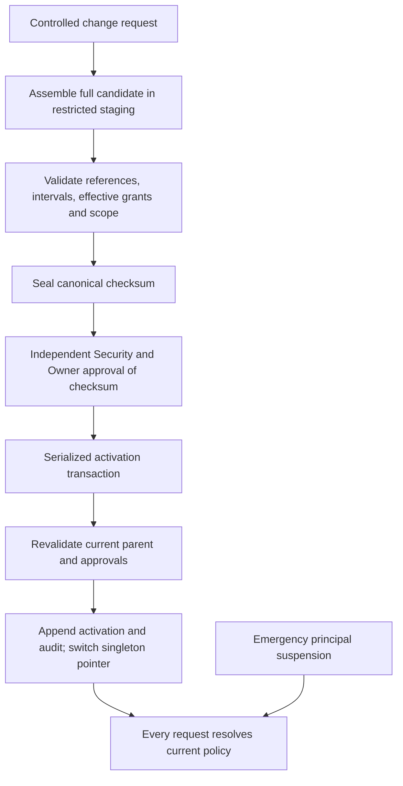

# Security Registry Data Model v1.0 — For Approval

**ID:** QP-DE-SRDM-001 | **Date:** 2026-11-26 | **Owner:** Database Engineer / Data Architect | **Reviewers:** Security Architect, BA, Solution Architect | **Approver:** Project Owner | **Status:** FOR APPROVAL | **Development:** NO-GO

## 1. Objective and boundaries

Persist QP-APR-008 role policy and QP-APR-007 semantic policy without changing the approved retail grain or M01–M09. Add a separate proposed security schema. This is a logical and physical-design candidate, not DDL, migrations, actual user provisioning, an authentication implementation or a proven PostgreSQL authorization boundary. Identity provider/session choice and independent nonforgeable DB scope binding remain separate hard gates.

## 2. Modeling decisions

Use explicit principal-wide store scope, versioned RBAC, no implicit role inheritance, no direct per-user metric grants, deny precedence and constrained optional role templates. Every optional grant is represented by a reviewed template or template revision, never by modifying an assigned role globally without a new policy review. Distinguish application roles from PostgreSQL execution roles. Only synthetic identities in MVP; issuer/subject identifiers are access-controlled pseudonymous identifiers, not passwords, bearer tokens or email addresses.

The preliminary eight-object proposal lacks explicit versioned principal/role state, M08 base-metric restrictions, separate reviewer evidence, atomic active-version pointer, and emergency revocation evidence. Expand to 15 logical objects below (including catalog and control records). These are new proposed decisions, not already approved DDL. The existing 12 business/governance logical entities remain intact.

## 3. Conceptual ERD

```mermaid
erDiagram
 PRINCIPALS ||--o{ PRINCIPAL_STATES : versions
 ROLES ||--o{ ROLE_STATES : versions
 PERMISSIONS ||--o{ ROLE_PERMISSION_GRANTS : granted
 POLICY_VERSIONS ||--o{ PRINCIPAL_STATES : binds
 POLICY_VERSIONS ||--o{ ROLE_STATES : binds
 POLICY_VERSIONS ||--o{ ROLE_PERMISSION_GRANTS : binds
 POLICY_VERSIONS ||--o{ PRINCIPAL_ROLE_ASSIGNMENTS : binds
 POLICY_VERSIONS ||--o{ PRINCIPAL_STORE_SCOPES : binds
 POLICY_VERSIONS ||--o{ ROLE_M08_BASE_GRANTS : binds
 POLICY_VERSIONS ||--o{ POLICY_APPROVALS : reviewed
 POLICY_VERSIONS ||--o{ GRANT_AUDIT : context
 POLICY_VERSIONS ||--o{ POLICY_ACTIVATIONS : activated
 POLICY_VERSIONS ||--o| ACTIVE_POLICY : selected
 PRINCIPALS ||--o{ PRINCIPAL_ROLE_ASSIGNMENTS : assigned
 ROLES ||--o{ PRINCIPAL_ROLE_ASSIGNMENTS : assigned
 ROLES ||--o{ ROLE_PERMISSION_GRANTS : grants
 ROLES ||--o{ ROLE_M08_BASE_GRANTS : restricts
 PRINCIPALS ||--o{ PRINCIPAL_STORE_SCOPES : scope
 STORES ||--o{ PRINCIPAL_STORE_SCOPES : permitted
 PRINCIPALS ||--o{ REVOCATION_EVENTS : revoked
 PRINCIPALS ||--o{ POLICY_APPROVALS : reviewer
 PRINCIPALS ||--o{ GRANT_AUDIT : actor
```

## 4. Logical data dictionary

All IDs are non-null unless stated. Proposed UUID internal principal and policy identifiers, BIGINT generated stable catalog/record identifiers and existing store BIGINT FK. UTC TIMESTAMPTZ instants; validity is [valid_from, valid_until), null end means open-ended. DB-generated timestamps and actor binding; no client-supplied trusted fields. Types are proposed, subject to DB ADR compatibility.

| Object | Grain and keys | Required attributes and rules |
|---|---|---|
| principals | One stable identity; PK principal_id UUID | issuer VARCHAR(255), subject VARCHAR(255), kind HUMAN/SERVICE, created_at; unique exact issuer+subject, never recycle |
| roles | Stable role/template identity; PK role_id BIGINT | role_code unique, template_family, created_at; optional roles explicit and constrained |
| permissions | Stable capability identifier; PK permission_id BIGINT | permission_code unique, kind CAPABILITY/METRIC/ADMIN, metric_id nullable restricted M01–M09; immutable identifier meaning, catalog changes reviewed |
| policy_versions | One full immutable sealed policy candidate; PK policy_id UUID | parent_policy_id nullable self FK, version_no unique, created_by principal FK, created_at, content_sha256, semantic_contract_ref, role_matrix_ref; checksum covers canonical policy rows and validity windows; no mutable published contents |
| principal_states | One principal per version; PK(policy_id,principal_id) | status ACTIVE/DISABLED, display_alias optional synthetic label; FK to policy and principal |
| role_states | One role per version; PK(policy_id,role_id) | status ACTIVE/DISABLED, template_definition_ref; FK to policy and role |
| principal_role_assignments | One versioned assignment interval; PK assignment_id BIGINT | policy_id, principal_id, role_id, valid_from, valid_until nullable, change_ref; composite FKs to principal_states and role_states; no duplicate overlapping intervals |
| role_permission_grants | One role/permission/version; PK(policy_id,role_id,permission_id) | effect ALLOW/DENY; FK to versioned role state and stable permission catalog |
| principal_store_scopes | One versioned principal/store interval; PK scope_id BIGINT | policy_id,principal_id,store_id FK retail.stores,valid_from,valid_until nullable,change_ref; FK to principal_states; no overlapping intervals for same version/principal/store |
| role_m08_base_grants | One role/base metric/version; PK(policy_id,role_id,base_metric_id) | effect ALLOW/DENY, base_metric_id restricted to approved OD-06 bases M01–M07, FK to role_states; base metric grant and M08 grant separately required |
| policy_approvals | One reviewer decision on exact sealed version; PK approval_id BIGINT | policy_id FK, reviewer_principal_id FK, reviewer_capacity SECURITY_REVIEWER/PROJECT_OWNER, decision APPROVE/REJECT, reviewed_checksum, decided_at, review_ref; distinct reviewers and creator; unique version/capacity decision, reject requires new candidate |
| policy_activations | Append-only activation ledger; PK activation_id BIGINT | policy_id FK, prior_policy_id nullable FK, actor principal FK, activated_at, activation_sequence unique, approval_refs via policy_id; monotonic sequence; no direct rollback to old version |
| active_policy | Singleton current-policy pointer; PK singleton_key fixed 1 | policy_id FK, activation_id FK, generation BIGINT; pointer must match activation's policy and generation, updated only atomically by trusted activator |
| revocation_events | Append-only emergency principal suspension or release; PK event_id BIGINT | principal_id FK, actor_principal_id FK, event_type SUSPEND/RELEASE, event_sequence unique, occurred_at, reason_code, authorization_ref; release requires independently reviewed policy and owner/security approval; effective suspension overrides all roles |
| grant_audit | Append-only sanitized policy/security change record; PK audit_id BIGINT | actor_principal_id FK, policy_id nullable FK, action_code, target_ref opaque, reason_code, request_id, occurred_at, before_hash nullable, after_hash nullable, outcome; no secrets, raw questions or monetary results |

Store identity FK references the existing stable retail store, not its mutable label or snapshot revision. Existence alone never creates entitlement. The semantic catalog and response allowlist are separately approved immutable application artifacts pinned by reference/hash, not editable formulas in the registry. Permission catalog includes chat.use, analytics.kpi/rank/compare/diagnose, evidence.read, users.manage, policy.manage, audit.read, metric.M01.read through metric.M09.read. Operational authority for approval/activation is separately protected, not derived from a self-created business role.

## 5. Integrity and proposed access paths

- Enforce version-consistent composite FKs; no cascade deletes; no update/delete of sealed policy contents, approvals, activation history or audit/revocation events by runtime roles. Candidate assembly occurs in restricted staging, sealed full snapshot inserted atomically; rejected candidates retained as immutable evidence.
- Exact issuer/subject uniqueness with case-sensitive matching, no whitespace rewriting. Missing or duplicate verified identity denies. Service principals cannot receive interactive business role assignments. Active catalog references required.
- Nonoverlap of assignment/scope validity intervals (range exclusion or locked validation after authorization ADR). Check nonempty interval and positive IDs where relevant. No wildcard scope or arbitrary direct metric grant.
- Index principal issuer/subject unique, version+principal assignments, version+role permission/base grants, version+principal store scopes and range checks, revocation principal+sequence, policy approval version, audit request_id and timestamp. Avoid duplicate PK indexes. Measure with synthetic fixtures only after GO.
- Snapshot content hash uses versioned canonical serialization, deterministic row ordering, exact identifiers and UTC timestamps. Hash alone is not proof of approval; protected writes, trusted actor binding and independently recorded reviewer decisions required.
- Proposed full policy copies simplify reproducibility at small demo scale; no mutable delta-only effective grants. Historical policy records are for audit, never authorize historic business snapshots.

## 6. Policy activation, revocation and evaluation

Activation uses a single serialization boundary shared by policy activator and emergency revocation service. Recheck parent against active pointer, checksum, reviewers, no self-grant, actor authorization, validity and grant combinations; rejected/missing/stale approvals fail closed. Atomically append activation and audit and switch pointer; any failure rolls back. Approval actors cannot be the creator or beneficiary of a grant increase; separate Security and Owner reviewers; initial bootstrap requires an independently controlled out-of-band trust anchor, not self-approved registry roles. Exact operational credential mechanism remains an identity/authorization ADR blocker.

Effective policy algorithm (specification, not executable code): verify authenticated issuer/subject; resolve current active generation and emergency revocation state; require active HUMAN principal and active role assignments at trusted current instant; collect role permissions, explicit deny wins across roles; independently resolve active explicit store grants; apply M08 base deny precedence, M08+base+compare grants; apply metric/operation/dimension/output constraints and approved inference checks; deny absent grants, no partial explicit scope; bind policy generation, revocation generation and earliest entitlement expiry to plan; independently enforce at DB and recheck before result/evidence output. For analytics require chat.use, evidence.read and function+metric permissions.

Validate every effective grant set over all time segments induced by assignment/scope validity boundaries, including future start/expiry and changes to roles. Exactly three of M01–M04 prohibited; M05+M07 requires M01+M02; no silent grant expansion. At runtime revalidate combination defensively. Explicit deny on any base or metric prevents its disclosure. Optional M08 base grants alone confer nothing; staff M08 only M06; manager defaults M04/M05/M06. Reject mixed role-specific scope requirements at provisioning. Runtime time checks use actual current time, not historical reporting timestamp.

Emergency suspension immediately blocks all chat and analytics upon committed revocation, independent of publication review. It only removes access, never grants it. Release requires separately approved current policy and controlled release event; activation alone must not clear suspension. Recheck revocation and policy before returning, including before model narrative egress; in-flight data already disclosed before revocation cannot be recalled. Serialize/check generation at final response authorization boundary; document residual transport race in ADR. Session invalidation and in-flight cancellation implementation remains pending. Do not claim instantaneous distributed revocation beyond this contract.

## 7. Example synthetic configuration (not actual grants)

| Principal | Template | Explicit stores | Result |
|---|---|---|---|
| demo_owner | OWNER | A,B | Revenue/diagnosis allowed for A,B; C not granted |
| demo_manager_a | MANAGER | A | M04/M05/M06, approved ranks/comparisons; B denied |
| demo_staff_b | SALES | B | M06 KPI only; revenue denied |
| demo_analyst_a | ANALYST_M04_KPI | A | M04 KPI and sanitized evidence only; bridge denied |
| demo_admin | ADMIN | none | users.manage only; chat denied |
| demo_suspended | SALES | A | Emergency suspension overrides grants |

Optional templates require separate approval, not automatically enabled by naming conventions. Business Owner role and Project Owner approval authority are distinct concepts. New store requires explicit grants through new approved policy. No real personal data or production deployment.

## 8. Acceptance specifications (not executed)

| ID | Scenario | Required outcome |
|---|---|---|
| SR-01 | Duplicate issuer+subject | Rejected |
| SR-02 | Same subject, different verified issuer | Distinct principal; no inherited grants |
| SR-03 | Missing/disabled identity or role | Deny |
| SR-04 | Orphan FK or cross-version assignment | Reject |
| SR-05 | Overlapping assignment/scope interval | Reject |
| SR-06 | Validity boundary exactly at end | Expired |
| SR-07 | Missing store scope or wildcard | Deny/reject |
| SR-08 | New store created | No automatic grant |
| SR-09 | Explicit scope A+B when only A granted | Entire request denied |
| SR-10 | Cross-role allow and deny | Deny |
| SR-11 | Exactly three monetary metrics after union | Candidate rejected |
| SR-12 | M05/M07 without M01/M02 | Candidate rejected |
| SR-13 | Future expiry creates forbidden combination | Reject before activation; runtime fail closed |
| SR-14 | M08 without base grant or compare | Deny |
| SR-15 | Staff M08 on M04 | Deny |
| SR-16 | Mixed role-specific store scope required | Refuse provisioning |
| SR-17 | Self-grant or same reviewer in both capacities | Reject |
| SR-18 | Checksum changed after review | Reject activation |
| SR-19 | Concurrent activation with stale parent | One consistent activation; stale candidate rejected |
| SR-20 | Failure between activation and pointer update | Atomic rollback |
| SR-21 | Attempt to edit sealed policy or audit | Deny |
| SR-22 | Emergency suspension during query | Suppress pending output after committed revocation |
| SR-23 | New policy activates while suspended | Suspension persists |
| SR-24 | Unauthorized release | Deny |
| SR-25 | Old policy/snapshot replay after revocation | Deny under current policy |
| SR-26 | Service identity assigned chat role | Reject |
| SR-27 | Admin attempts grant activation | Deny unless separately protected operational authority; no self-grant |
| SR-28 | Missing active pointer or inconsistent generation | Fail closed |
| SR-29 | Raw secret or sensitive values in audit payload | Reject/redact |
| SR-30 | Direct caller spoofs principal/GUC/role | Cannot authorize; DB ADR proof required |
| SR-31 | Inference via sparse/differencing queries | Assess residual risk before GO; no blanket confidentiality claim |
| SR-32 | In-flight policy change before narrative or evidence response | Suppress unauthorized output; reauthorize |

All RPM-01–28 and DBSEC-01–12 remain applicable. No tests executed. Acceptance target: all defined mandatory authorization and integrity assertions pass after explicit GO; independent BA/DB/Security review and threat evidence required.

## 9. Approval and open boundaries

Approve separately: SR-D01 separate schema and 15-object data model; SR-D02 versioned roles, principal states and explicit M08 base grants; SR-D03 sealed full snapshots, distinct reviewers and atomic activation; SR-D04 temporal validation and deny-first evaluation; SR-D05 emergency suspension/release and sanitized audit; SR-D06 synthetic fixtures and SR-01–32 test specifications.

Pending: exact PostgreSQL nonforgeable principal binding, RLS vs constrained routines, privileged ownership and search_path, role grants, pool isolation, bootstrap trust, IdP/session/CSRF and cancellation details, audit retention and recovery policies, inference validation, consolidated physical design v1.1 and full PRD. This document does not close PRE-04/PRE-05/PRE-06 by itself. No DDL, coding, deployment or implementation tests until separate Development GO.
