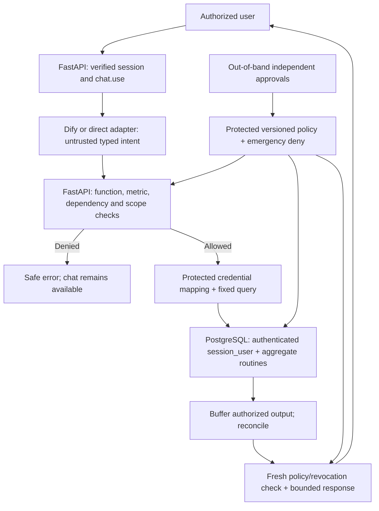

# Security Registry Security Review v1.1 — For Approval

**Document ID:** QP-SEC-SR-REVIEW-001 | **Revision:** 1.1 | **Date:** 2026-11-27 (Asia/Singapore)  
**Authority:** Security Architect — design review only  
**Owner disposition:** PENDING — CHANGES REQUIRED on v1.0; revised review submitted for approval  
**Registry disposition:** NOT APPROVED; targeted revision and coordinated ADRs required  
**Development:** NO-GO. No coding, DDL, migrations, data generation, deployed privileges or implementation tests authorized.

## 1. Revision mandate and reviewed baseline

The Project Owner requested changes to Document 29, then explicitly requested reassessment of security necessity, practical FastAPI/Dify/PostgreSQL implementation feasibility, and excessive development blockers. This later instruction supersedes the review-acceptance disposition in [Document 30](30_SECURITY_REGISTRY_REVIEW_DISPOSITION_RECORD.md) for the purpose of the current review. It authorizes revision of this review, not approval of its new recommendations or the registry. Preserve Document 30 as historical evidence; do not infer QP-APR-009 or Development GO.

| Source | Reviewed blob / status |
|---|---|
| Document 29 v1.0 | a7edabe84ec751c294eb86acec5bbddf26e68566; [historical copy](https://github.com/LCK0629/dify_quertPilot/blob/bbd0157118a0b7954af57e26ff30a46e67c1cb3b/docs/phase-1/29_SECURITY_REGISTRY_SECURITY_REVIEW_FOR_APPROVAL.md) |
| [24 Registry candidate](24_SECURITY_REGISTRY_DATA_MODEL_V1_0.md) | 576c9a3b97ca6bb040e55a51c5c1391eaf9def21; not approved |
| [25 PM review](25_SECURITY_REGISTRY_REVIEW_NOTES.md) | advisory; prior reviewed blob 2edfe7d617b8b73af4c2a3f6bdc4ee1c9d85d63d |
| [22 Role matrix](22_ROLE_PERMISSION_MATRIX_V1_0.md) | b5bbe201146f7e3c85e46a73c7278d681bdf9291; [23 QP-APR-008](23_ROLE_PERMISSION_APPROVAL_RECORD.md) controlling |
| [20 OD resolution](20_OD_DECISION_RESOLUTION_V1_0.md) | [21 QP-APR-007](21_OD_DECISION_APPROVAL_RECORD.md) controlling |
| [26 DB authorization candidate](26_POSTGRESQL_AUTHORIZATION_ADR_CANDIDATE.md) | 5172c89c9cf745781d850e96d77acf8108283a3e; Option A proposed, not approved |
| [28 Closure board](28_DECISION_CLOSURE_EXECUTION_BOARD.md) | 41ea51b215ab38df75bcfcedee723287a0c12dbe; independent gates remain |

This is a repository document review, not an implementation audit. No benchmark, privilege probe, source-code execution or penetration test was performed. Hashes identify reviewed artifacts, not runtime signing credentials.

## 2. Executive recommendation: proportional security

Keep all approved business and role rules. Recommend a **bounded synthetic, single-tenant, local-first portfolio MVP**, one modular FastAPI backend, React, a replaceable Dify/direct intent adapter, and PostgreSQL 17. Avoid introducing an enterprise IAM platform, distributed policy engine, mandatory HSM/PKI, SIEM or microservices solely for this MVP.

The existing registry is directionally sound but not yet approved. Prefer a **targeted design revision**, not a wholesale redesign or a fixed table-count target. Keep genuine trust-boundary decisions as design gates; move executable verification to the authorized implementation/release stages. Never treat a deferred implementation as a waived security control.

| Class | Meaning |
|---|---|
| P0-D | Blocking design decision: settle and approve before Development GO; paper design and test specification are sufficient evidence at this stage |
| P1-I | Mandatory implementation and executable acceptance after GO, before any interactive demo/release; define owner and oracle now |
| R | Explicit residual risk for strictly bounded synthetic MVP; require Security recommendation and Owner acceptance before GO; no automatic acceptance |
| P2-F | Optional future enhancement; not a GO blocker if the underlying mandatory control is already preserved |

A single finding can require a P0-D design decision and P1-I verification. Severity and lifecycle stage are different. P0-D does not imply an implementation test must already pass.

## 3. Non-negotiable approved policy

- Six personas, approved constrained role templates, no implicit inheritance, deny precedence across effective union, no arbitrary per-user metric grant.
- Every analytics principal including Owner has explicit principal-wide stores; new stores not auto-granted. Mixed per-role scopes rejected at provisioning. Explicit unauthorized store or all-store request denies the entire query.
- Successful analytics requires chat.use, evidence.read, operation and metric grants, approved dependencies, OD-06 semantic bounds and current scope. No chat grant means no adapter call; a denied metric does not disable chat.
- M08 requires compare, M08 and an approved base; optional Sales Staff base M06 only, Manager defaults M04/M05/M06. M09 requires M04 and diagnose; optional bridge requires M01/M02/M03 in addition. M04 and M07 may use protected internal inputs without exposing them.
- Reject effective grants containing exactly three of M01–M04, not all four; reject M05+M07 unless M01 and M02 granted. Evaluate all valid-time segments and combined roles.
- Historical business snapshots use current authorization; no raw SQL, event rows, unrestricted exports, profit, M10 inventory, real PII, or unauthorized evidence/metadata.
- Separate Project Owner approval authority from business Owner role; System Admin users.manage gives no policy activation, audit or finance privilege. Independent Security + Owner approval and emergency controls remain required.
- Preserve approved M01–M09, OD-01–07, retail grain, exact arithmetic, event recognition and coverage/finality. No new suppression rule that changes approved outputs without BA/Owner change control.

## 4. Practical target architecture

### FastAPI
One Python application with internal authentication, authorization, registry, adapter, deterministic compiler, gateway, response and audit modules. Use server-validated identity and session; same-origin session protection and CSRF for cookie-authenticated requests. Strict request/intent schemas reject extra authority-bearing fields. No client-supplied principal, grants, login, raw SQL or arbitrary URL accepted. Dify output cannot authorize or expand scope. Deny before business SQL on any failed validation.

### Dify
Only bounded intent interpretation; generic approved catalog and minimized question, no credentials, raw rows, unrestricted tools or callback to privileged API. P0 recommendation: deterministic result narrative; defer optional second LLM narrative until its output/egress controls are verified. If later enabled, use only authorized output fields and repeat authorization before egress. Dify/direct provider, license and retention decision remains separate.

### PostgreSQL
Recommend Option A from Document 26 for review: separate restricted login per synthetic human principal and narrow aggregate functions. FastAPI selects credential from server-owned mapping of authenticated issuer+subject; DB derives identity from session_user and separately protected login mapping, not current_user inside SECURITY DEFINER. Restrict roles to LOGIN, no superuser, CREATEROLE, CREATEDB, REPLICATION, BYPASSRLS or privilege-changing memberships. No direct raw-table access, DML or DDL. Grant only approved aggregate routines; fixed search_path including safe pg_temp placement, schema-qualified objects, non-superuser definer, no unsafe dynamic SQL, transactional PUBLIC EXECUTE revocation. Verify role/view/RLS semantics; RLS is optional supplementary protection, not a substitute for independent authorization.

For small demo choose a fresh restricted connection per analytics request initially; isolated per-login pool only if benchmarks justify it. Do not share authenticated DB connections between principals or trust a caller-supplied GUC. The backend remains trusted to authenticate and choose the right credential; a compromised backend/credential vault is residual risk, not solved by session_user. No final option or grants approved here. Keep separate protected migration, ingest, publication, registry and audit roles.

### Policy approval without enterprise infrastructure
Use a controlled offline operator workflow, not chatbot or self-service role editing. Independent Owner and Security Reviewer capacities must originate in a protected bootstrap manifest or equivalent external trust anchor, not roles editable through the candidate registry. Bind reviewer identities to authenticated operator evidence and the exact canonical policy digest, prohibit creator self-review and beneficiary conflicts, require distinct approvals, then a restricted activator verifies both and atomically advances the generation. Protected OS/service credentials and append-only review/activation records are a candidate baseline; a cryptographic signature service/HSM is not mandatory if the reviewed threat model and protected workflow establish equivalent authority. Define bootstrap, replacement, loss/recovery and reject/re-review path. Git hashes alone are not proof of reviewer identity. No weakening of approved dual review.

### Revocation and concurrency
Use committed emergency suspension independent of normal publication; trusted revoker, separate independently reviewed release, monotonic generation/sequence. Capture policy generation, revocation sequence, principal and expiry at query start; DB checks current grants at routine entry. After DB returns use a fresh transaction/current policy read, not the old repeatable-read snapshot, to verify before any result/evidence egress. If stale, expired or denied, discard buffered answer. Disable streaming, persistent conversation answers and shared result caches in MVP.

Design must define an output authorization linearization point: serialize final authorization/response handoff with policy/revocation update via a bounded shared gate or equivalent reviewed protocol; do not hold a DB lock over unbounded network I/O. Revocation committed before that handoff denies; already authorized/in-flight bytes cannot be recalled, and transport delay is bounded/recorded as residual risk. Every later evidence/follow-up request is newly authorized. Use statement timeout and cancellation where feasible; immediate forced cancellation of every in-flight DB operation is not necessary to prevent disclosure if output suppression works. Session entitlements are re-resolved each turn; invalidation on suspension, no stale token permission authority.

## 5. Finding-by-finding revised disposition

All twelve original findings retained by ID. No finding marked fixed.

| Finding | Before GO (P0-D where specified) | After GO (P1-I) | Residual/future treatment |
|---|---|---|---|
| SEC-SR-01 Principal binding | Choose nonforgeable DB identity ADR; mapping and trust assumptions | Verify distinct logins and spoof denial | R01 backend/vault compromise |
| SEC-SR-02 Trusted approvals | Approve bootstrap, independent capacities and exact-version activation | Test unauthorized signer/self-grant/release and recovery | P2 enterprise signing infrastructure |
| SEC-SR-03 Policy integrity | Specify canonical coverage: catalog semantics, templates, roles, principal binding, grants, intervals, M08 bases, semantic/role-contract digests; immutable referenced artifacts | Test tamper and stale digest rejection, atomic activation | P2 external transparency ledger |
| SEC-SR-04 Revocation race | Approve fresh recheck, generation, expiry and bounded handoff contract; no streaming/cache | Race tests with independent connections; timeout/cancel and suppression | R02 already handed-off bytes; P2 advanced distributed cancellation |
| SEC-SR-05 Inference | Preserve approved exact-three/M05+M07 and disclosure policies; BA/Security review sparse/differencing cases and residual risk | Golden/negative output tests incl. labels and metadata | R03 synthetic aggregate inference; P2 history/privacy engine only after stronger confidentiality requirement |
| SEC-SR-06 Object count | Explain control-to-storage mapping and one bounded simplification alternative; no arbitrary count | Validate keys, joins, invariants and maintainability | No mandatory quantitative cost benchmark before coding |
| SEC-SR-07 Temporal integrity | Approve UTC trusted clock, half-open intervals, full version joins, all-segment effective-union and fail-closed contract | Boundary, overlap, stale and concurrent tests | P2 advanced scheduling UI |
| SEC-SR-08 Audit | Specify actor, sanitized events, independent reader, failure behavior, local retention/recovery | Verify append-only grants, audit failure handling, backup/restore | R04 privileged OS/DB admin tampering; P2 SIEM/WORM |
| SEC-SR-09 Lifecycle | Approve issuer/subject/session, bootstrap/deprovisioning and credential separation in identity ADR | Test expiry, logout, suspend, rotation, cross-login isolation | P2 automated enterprise lifecycle/SSO federation |
| SEC-SR-10 DB privileges | Approve routine signatures, ownership, grants, mapping and attacker model | Actual PostgreSQL privilege/definer/SET ROLE/PUBLIC tests | P2 additional RLS only if useful and reviewed |
| SEC-SR-11 Output leakage | Define common output allowlist for all surfaces; no optional LLM narrative in initial candidate | Test denied labels, evidence, logs, errors and egress | P2 persistent chat/export only after separate design |
| SEC-SR-12 Test traceability | Approve scenario crosswalk plan, oracle, owner and evidence location | Execute and reconcile all applicable test IDs | No duplicate test execution merely because IDs differ |

## 6. Registry complexity and control-equivalence assessment

15 current objects are proposed, not mandated. Recommend compare the following **design candidates**; neither is selected by this review.

| Control | Existing A (15 objects + binding) | Candidate B (12 objects including binding; conceptual only) |
|---|---|---|
| Stable identity and login binding | principals + protected mapping | principals + protected db_login_bindings (2) |
| Role and permission catalog | roles, permissions | versioned role_templates with immutable referenced permission catalog manifest (1); typed permission codes and validated catalog membership |
| Policy versions and principal/role state | policy_versions, principal_states, role_states | policy_versions + principal_states (2); role state in versioned role_templates; immutable full-snapshot semantics |
| Assignment, grants, store scope, M08 | four entitlement relations | principal_role_assignments, role_permission_grants, principal_store_scopes, role_m08_base_grants (4) |
| Reviews and activation | policy_approvals, policy_activations, active_policy | policy_approvals + policy_lifecycle (2); append-only activation events, protected current pointer derived from latest committed activation under serialized update |
| Emergency deny and audit | revocation_events, grant_audit | security_events (1); typed append-only event variants with independently restricted revoker and audit writer interfaces; emergency deny independent of publication |

B count 2+1+2+4+2+1=12 conceptual storage objects, excluding versioned manifest artifact, views, functions, indexes and roles. It requires composite version FKs, stable immutable role codes, catalog digest and typed membership validation, unique active activation sequence, indexed latest-event resolution and distinct write authority. Combining revocation/audit and deriving the active pointer may be **harder** than separate tables; assess before selecting. A count is 16 if binding is a separate object. A is likely simpler to reason about because of explicit lifecycle tables; B could reduce joins/catalog duplication but adds event validation and operational logic. Earlier eight-object model without equivalent controls remains unsuitable. No actual migration or benchmark. DB Engineer should produce keys, privileges, control-equivalence and qualitative maintenance comparison, choose the easier verifiable design rather than optimize table count. A short documented comparison suffices; a second complete physical schema is unnecessary before choosing.

## 7. Consolidated pre-development security decisions

Four coordinated security design gates replace fragmented duplication; they do not remove other readiness gates or change Document 28 issue closure criteria without PM/Owner approval.

| Gate | Required paper evidence before GO | Owner / tracker |
|---|---|---|
| SG-01 Identity and independent DB enforcement | Selected identity/session and DB auth ADR, protected mapping, routine and privilege matrix, trust model, negative-test protocol | Security + DB + Backend; #2/#3 |
| SG-02 Registry and policy governance | Exact revised registry, object comparison, canonical integrity, temporal invariants, independent bootstrap/dual review, audit and activation | DB + Security + Owner; #1/#5 |
| SG-03 Revocation and output policy | Generation/expiry/fresh recheck, handoff contract, output allowlist, approved matrix consistency and residual risks | Security + BA + Backend; #1/#3/#4 |
| SG-04 Test and release contract | Unified scenario specifications, owners/oracles, risk acceptance, no live release until mandatory tests pass | QA + Security + Owner; #7/#9 |

Other existing PRE gates (PRD, DB amendment, Dify choice, evaluation, research/explicit limitation acceptance and separate written GO) remain. Resolve SG-01–03 jointly rather than requiring circular sequential signoffs. A design can be reviewed with explicit dependencies but no final registry approval while mandatory trust decisions unresolved. No implementation evidence is required before implementation authorization; no design approval implies release approval.

## 8. Residual risk and deferrals

| ID | Risk and bounded condition | Proposed mitigation / disposition |
|---|---|---|
| R01 | Trusted FastAPI/credential vault compromise could enable access across demo identities | Local-only isolated host, least privilege, restricted secret store, no real data, rotation and recovery plan. Security + Owner must explicitly accept before GO |
| R02 | Bytes handed to transport before committed revocation cannot be recalled | No streaming, bounded handoff, fresh checks, no persistent cached answers; document timing limit; explicit acceptance |
| R03 | Permitted aggregates may allow external knowledge, collusion, differencing or sparse inference | Approved inference restrictions mandatory; BA review, synthetic data only, no transaction rows/export, explicit risk acceptance; no strong confidentiality claim |
| R04 | Privileged host/DB admin can alter local audit/storage | Restricted operator roles, sanitized append-only records, protected backups and digest checks; no claim of tamper-proof audit; explicit acceptance |

Proposed future backlog: HSM/managed signing, SIEM/WORM, distributed revocation, automated account federation, multi-tenant isolation, persistent chat, exports, query-history inference engine, optional AI narrative, public hosting. These are not prerequisites for the bounded MVP unless required to preserve an approved control. Real data/public deployment requires new threat model and signoff.

Audit MVP proposal: no question text, amounts, token or secret; request ID, trusted actor, action, outcome, reason, policy/generation and timestamps. Independent audit reader, append-only writer; mandatory change audit failure rolls back the change; authorization/response audit failure suppresses successful disclosure. Proposed retention 90 days for synthetic request logs and retain policy approval history through project lifecycle, subject to Owner approval; protected backup/restore and controlled deletion plan. No external SIEM necessary.

## 9. Revised SR-D01–SR-D06 recommendation

| Decision | v1.1 recommendation |
|---|---|
| SR-D01 | Targeted revision: choose A or control-equivalent simpler model; no prescribed count |
| SR-D02 | Support approved RBAC/M08 semantics; finalize immutable meaning and effective union |
| SR-D03 | Revise trust anchor and dual review/activation; offline operator baseline, no mandatory enterprise PKI |
| SR-D04 | Support temporal policy; specify trusted clock, intervals and generation |
| SR-D05 | Revise independent suspension/release, bounded pre-output gate and minimum audit |
| SR-D06 | Support test specifications; actual execution after GO and before demo/release |

All six remain unapproved. The Owner may approve the revised review approach, not the registry itself.

## 10. DB-R01–DB-R06 streamlined work packages

| Work | Required deliverable | Accountable roles |
|---|---|---|
| DB-R01 | Registry v1.1 exact schema/keys, integrity and identity mapping | DB + Security |
| DB-R02 | Short A/B control-equivalence and maintenance comparison; choose recommendation | DB + Architect |
| DB-R03 | Coordinated DB authorization ADR, routines and trust/privilege model | Security + DB + Backend |
| DB-R04 | Identity, bootstrap, approval, activation, revocation and audit ADR | Security + Architect + DB |
| DB-R05 | Approved RPM/OD mapping and synthetic inference risk review | BA + Security |
| DB-R06 | Unified test specification crosswalk and future evidence plan | QA + DB + Security |

Combine DB-R01/R02 in one registry artifact; cross-reference DB-R03/R04 rather than duplicate; DB-R05/R06 may be concise appendices. No additional large document required solely to repeat existing content.

## 11. Acceptance and phase separation

| Criterion | Before GO design evidence | After GO implementation/release evidence |
|---|---|---|
| SR-AC-01 | Pin exact revised version/commit/blob and finding dispositions | Verify implemented version matches |
| SR-AC-02 | Select and approve nonforgeable identity mechanism | Real DB distinct-login and spoof tests |
| SR-AC-03 | Independent bootstrap/approval/recovery design | Self-review, unauthorized activation/release negatives |
| SR-AC-04 | Immutable canonical semantics, FK/interval/effective union design | Tampering, overlap and cross-version tests |
| SR-AC-05 | Revocation/handoff and no-streaming contract | Concurrent revocation and stale-response suppression |
| SR-AC-06 | Approved RPM/OD mapping, inference/output rules | Golden and negative metric/scope tests |
| SR-AC-07 | Control-equivalent comparison and selected model | Verify schema and operational simplicity |
| SR-AC-08 | Audit/retention/recovery and risk disposition | Audit failure and restore checks |
| SR-AC-09 | Crosswalk SR-01–32, RPM-01–28, DBA-01–18, DBSEC-01–12 where defined; add signer/catalog/pool/race/audit cases; named role owners, oracle, evidence path | Execute applicable tests, deduplicate execution only with traceability, independent reviewer records evidence |
| SR-AC-10 | Explicit SR-D01–06 and residual risk dispositions; independent Security/DB/BA review | Confirm no unapproved implementation drift |

**Development GO:** Separate written QP-APR-DEV-GO-001 after design and readiness gates resolved. It authorizes implementation and tests, not public access. **Release/demo gate:** after GO, run mandatory tests on isolated synthetic environment, record evidence, resolve critical/high failures or formally approved bounded noncritical residuals, and obtain separate release acceptance. Zero unauthorized disclosures in defined negative suite; no claim of universal security. No tests have run.

## 12. Owner decision requested

Approve or revise these review proposals separately:
- RV-D01: risk-based P0-D / P1-I / R / P2-F classification and stage separation.
- RV-D02: bounded local-first synthetic MVP, simple operator workflow, deterministic narrative, no streaming/shared cache.
- RV-D03: targeted DB-R01–06 revision and compact control-equivalence comparison.
- RV-D04: retain all approved RPM/OD controls, independent DB boundary and dual approvals; approve residual-risk *review process*, not automatic acceptance.
- RV-D05: coordinated SG-01–04 design gates and mandatory post-GO release verification.

Recommendation: approve the revised review direction and request targeted registry revision. **Current owner disposition PENDING. Registry NOT APPROVED. Development NO-GO.** No QP-APR-009 or QP-APR-DEV-GO-001 issued. Issues #1–9 remain governed by their own closure evidence.

References: [PostgreSQL 17 session identity](https://www.postgresql.org/docs/17/functions-info.html), [CREATE FUNCTION security](https://www.postgresql.org/docs/17/sql-createfunction.html), [SET ROLE](https://www.postgresql.org/docs/17/sql-set-role.html), [RLS](https://www.postgresql.org/docs/17/ddl-rowsecurity.html), [FastAPI security](https://fastapi.tiangolo.com/tutorial/security/), [OWASP API Security](https://owasp.org/API-Security/). These are reference pointers, not claims of live verification or tested compatibility.
