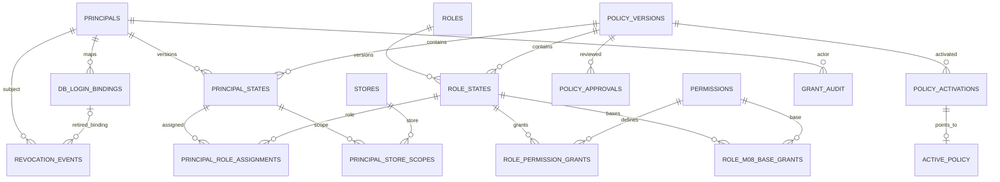

# Security Registry Data Model v1.1 — For Approval

QP-DE-SRDM-001 | Revision 1.1 | 2026-11-27 | Database Engineer / Data Architect
**v1.1 targeted revision 1 — FOR REVIEW — REGISTRY NOT APPROVED — DEVELOPMENT NO-GO**

Controlling limited approval: [Document 33](33_SECURITY_REGISTRY_V1_1_LIMITED_DESIGN_APPROVAL_RECORD.md), SEL-01–04. Exact historical v1.1 candidate remains at commit `faec078f82a56e34aef8c33b09d6ec4082cf688f`. Model A is selected; RBAC/M08 direction and test framework approved only. T1 design revision submitted; T2–T4 database-side proposals below require joint review; T5 remains BA/QA/Security-owned.

## 1. Baseline and scope

Prepared under [Document 31](31_SECURITY_REVIEW_V1_1_APPROVAL_RECORD.md), QP-DEC-SR-REVIEW-002, RV-D01–05. Preserve [24](24_SECURITY_REGISTRY_DATA_MODEL_V1_0.md) and [25](25_SECURITY_REGISTRY_REVIEW_NOTES.md) as history; follow [29](29_SECURITY_REGISTRY_SECURITY_REVIEW_FOR_APPROVAL.md) v1.1. Controlling OD/RPM approvals [21](21_OD_DECISION_APPROVAL_RECORD.md) and [23](23_ROLE_PERMISSION_APPROVAL_RECORD.md) unchanged. Local-first single-tenant synthetic-only MVP, deterministic narrative, no streaming, persistent answers or shared answer cache. DB-R01/R02 combined below; R03/R04 candidate contracts cross-reference [26](26_POSTGRESQL_AUTHORIZATION_ADR_CANDIDATE.md) and issues #2/#3; R05/R06 appendices. No independent sign-off inferred.

## 2. Recommended model: A, 16 logical storage objects

Retain explicit normalized catalogs, lifecycle pointer, revocation and audit; add protected DB login binding. Selected by SEL-01; final schema and AUTH decisions remain pending. No change to twelve retail/governance entities or business grain. Proposed protected security schema; no human analytics login may read or mutate it directly.

## 3. Logical-to-physical candidate dictionary (DB-R01)

UUID for principal/policy/binding identifiers, BIGINT for other IDs and sequences, TIMESTAMPTZ UTC instants, TEXT exact case-sensitive codes under deterministic comparison, BYTEA 32-byte SHA-256, BOOLEAN where needed. Required except explicitly nullable. All FKs restrictive, no cascading deletion. PK denotes primary key, UQ unique. Fields below are design contracts, not DDL.

| Object / grain | Keys and attributes | Integrity / owner |
|---|---|---|
| principals / stable person or service | principal_id PK; issuer, subject UQ pair; kind HUMAN/SERVICE; created_at | exact verified issuer/subject; immutable kind and identity; never recycle; protected provisioner |
| db_login_bindings / immutable login generation | binding_id UUID PK; principal_id FK; cluster_id UUID; db_role_name TEXT; db_role_oid BIGINT; credential_generation BIGINT; valid_from TIMESTAMPTZ; valid_until nullable; provisioning_ref | UQ(binding_id,principal_id), UQ(cluster_id,db_role_name), UQ(cluster_id,db_role_oid), UQ(principal_id,credential_generation); positive generation/OID; permanent name/OID reservation within cluster epoch; immutable after insertion; protected provisioner |
| roles / stable role template identity | role_id PK; role_code UQ; template_family; created_at | immutable identity/family, constrained approved templates; catalog owner |
| permissions / stable capability or metric identity | permission_id PK; permission_code UQ; kind; metric_id nullable; meaning_digest | immutable semantics; new meaning requires new reviewed code/version; catalog owner |
| policy_versions / sealed full snapshot | policy_id PK; version_no UQ; parent_policy_id nullable FK; creator_principal_id FK; created_at; sealed_at nullable; canonical_version; content_digest nullable until seal; semantic_contract_digest; rpm_digest; evaluator_digest; trust_manifest_digest | draft to sealed once; immutable after seal; parent must match active at activation; policy author/sealer |
| principal_states / principal per policy | PK(policy_id,principal_id); FKs policy/principal; status ACTIVE/DISABLED; binding_id nullable FK; alias nullable | composite FK (binding_id,principal_id) to binding UQ; human with analytics requires valid protected mapping, services no interactive grant |
| role_states / role per policy | PK(policy_id,role_id); FKs policy/role; status; template_digest | immutable approved template reference; policy author before seal |
| principal_role_assignments / assignment interval | assignment_id PK; policy_id,principal_id,role_id; valid_from,valid_until nullable; change_ref | composite FKs to principal_states and role_states; no overlaps per policy/principal/role |
| role_permission_grants / role permission per version | PK(policy_id,role_id,permission_id); effect ALLOW/DENY | composite FK role_states; FK permissions; reject unknown or invalid template combinations |
| principal_store_scopes / store interval | scope_id PK; policy_id,principal_id,store_id; valid_from,valid_until nullable; change_ref | composite FK principal_states; FK retail.stores stable identity; no overlaps per policy/principal/store; no wildcard |
| role_m08_base_grants / role base per version | PK(policy_id,role_id,base_permission_id); effect | composite FK role_states; FK permissions restricted to M01–M07 metric codes; separate compare/M08/base grants required |
| policy_approvals / independent exact-digest decision | approval_id PK; policy_id FK; reviewer_principal_id FK; capacity; decision APPROVE/REJECT; reviewed_digest; trust_manifest_digest; operator_evidence_ref; decided_at | UQ(policy_id,capacity); distinct reviewers; no creator/beneficiary; capacity verified outside registry; reject requires new candidate |
| policy_activations / committed activation | activation_id PK; policy_id FK UQ; prior_policy_id nullable FK; sequence UQ; actor_principal_id FK; owner_approval_id,security_approval_id FKs; activated_at; digest | approval FKs additionally bound to same policy/digest/capacity; monotonic sequence, no reactivation; protected activator |
| active_policy / singleton | singleton_key PK fixed 1; policy_id,activation_id,generation; FK composite to activation UQ(policy_id,activation_id,sequence) | pointer/generation must match; updated only in same activation transaction; missing denies |
| revocation_events / typed emergency transition | event_id BIGINT PK; sequence BIGINT UQ; principal_id FK; actor_principal_id FK; type SUSPEND/RELEASE/BINDING_RETIRE; binding_id UUID nullable; occurred_at TIMESTAMPTZ; reason_code; authorization_ref; release_policy_id nullable FK; supersedes_event_id nullable FK | FK(binding_id,principal_id) to binding UQ; binding_id required only for BINDING_RETIRE; unique retirement per binding; RELEASE requires current policy and exact latest SUSPEND predecessor; SUSPEND/RETIRE cannot carry release fields; serialized append-only, independent revoker/releaser |
| grant_audit / sanitized event | audit_id PK; actor_principal_id FK nullable only for unauthenticated attempt; policy_id nullable FK; generation nullable; request_id; action_code; target_ref opaque; outcome; reason_code; occurred_at; before_digest/after_digest nullable; previous_digest,event_digest | append-only restricted writer; independent reader; mandatory audit failure blocks change or response |

### T1 — Immutable DB binding retirement (supersedes the earlier alternative mutable interval)

The original approved validity window is immutable, including nullable end. Retirement is a terminal BINDING_RETIRE event, never an UPDATE to the binding. A release of principal suspension cannot revive a retired binding. The current policy references at most one binding per human, via the composite FK. New binding creation may precede activation but gives no rights until a sealed new policy selects it. A human with no selected valid binding cannot execute analytics. A binding is effective only if selected by current policy, inside its original validity window, not retired, principal not suspended, cluster/role identity matches and session is current. Missing, ambiguous or inconsistent state denies. Check retirement independently of business snapshot and policy creation time. Evaluate suspension/release events separately from binding retirement; do not treat the latest event of any type as a principal release. Retirement is unique and irreversible; idempotent retry returns existing event without changing authority. Index retirement by binding_id and principal suspension by principal_id/sequence with event-type predicate.

Generate ASCII login names under a reserved prefix, e.g. qp_h_ plus 32 lower-case hexadecimal UUID characters, exactly 37 bytes; never accept supplied names, quoted variants or truncated identifiers. Verify actual catalog name byte-for-byte, role OID, LOGIN status and least privileges after provisioning; fail if server identifier limit is insufficient. Reserve name/OID forever in that cluster epoch even after role removal. If PostgreSQL allocates a previously reserved OID, reject provisioning and recover under protected procedure; OID alone never proves identity. cluster_id is a protected deployment-epoch UUID bound to actual server identity and endpoint configuration, not a client GUC. Backup/restore, clone or replacement cannot silently reuse an epoch: stop analytics, establish new protected epoch, invalidate prior sessions and bindings, provision new identities and activate reviewed policy before reopening. Compare verified server identity at startup and reconnect; cluster identity attestation details remain AUTH-D02. No secrets in registry.

Rotation/rebind: protected operator first suspends principal and retires prior binding under common authorization gate, disables old LOGIN and revokes vault access; terminate old connections best effort, invalidate session/credential routes. Create new non-reused login and monotonically increasing credential_generation, verify mapping; seal and independently approve new policy; activate then independently authorize principal RELEASE. No overlap of effective binding, no automatic release. Failures leave principal denied or system quarantined. Expiry uses actual UTC wall clock, not transaction start. Include binding end, assignment/scope boundaries and session expiry in authorization horizon. Every subsequent routine and final handoff rechecks retirement. Password rotation that retains login is not the candidate lifecycle; new generation uses new login. AUTH-D02 remains pending; no real roles created.

T1 oracle: old binding remains byte-identical after retirement; old login fails even with historical snapshot or principal RELEASE; mismatched subject/cluster/OID/name, duplicate retirement, truncated name, reused epoch or stale generation cannot widen authority. Positive: newly approved binding after independent release permits only current explicit stores and grants. Tests not executed.

Versioned rows writable only before seal; seal validation and canonical digest in one serialized transaction. Prevent later UPDATE/DELETE/INSERT under sealed parent. Catalog rows referenced by policy cannot change meaning. No trusted authority derived from alias, role code supplied by user, or grant row alone. Proposed indexes: all uncovered FK columns; (policy_id,principal_id,valid_from), (policy_id,role_id), (principal_id,sequence DESC) emergency lookup, unique activation sequence, binding login lookup, audit request/time. Interval overlap checks require exclusion constraints or serialized validation; physical choice pending. No performance measurement claimed.

## 4. Full vs reduced model (DB-R02)

| Control | A: 16 objects | B: 12 objects | Equivalence condition / trade-off |
|---|---|---|---|
| Identity | principals + db_login_bindings | same two | same protected mapping/retirement |
| Role/catalog | roles + permissions + role_states | role_templates keyed (policy_id,role_code), immutable permission manifest | B validates typed permission codes against pinned immutable manifest, stable role meaning across versions; loses ordinary catalog FK unless equivalent validation |
| Policy/principal | policy_versions + principal_states | same two | full sealed snapshots and same binding relationship |
| Entitlements | four separate relations | same four, role_code composite FKs; permission codes manifest-validated | same deny and interval rules, M08 separate |
| Approval | policy_approvals | same | independent operator trust unchanged |
| Activation | policy_activations + active_policy | policy_lifecycle append-only activation ledger; current derived from max committed sequence | serialized activation, parent validation and unique sequence; missing/ambiguous state denies |
| Revocation/audit | two separate ledgers | security_events typed variants | restricted revoker vs audit writer routines; event-specific required fields, independent emergency state and indexed sequence; ordinary audit cannot manufacture RELEASE |

B totals 2+1+2+4+1+1+1=12. A totals 2+3+2+4+1+2+2=16. Both exclude protected external trust manifest, immutable contract artifacts, session store, vault, PostgreSQL roles, views, indexes and routines. These remain real operational dependencies. A has more FK joins and migration objects but simpler separate privileges, explicit active pointer and independent emergency audit semantics. B reduces table count, adds typed-event branching, manifest validation and latest-event resolution complexity. No quantitative benchmark needed before GO; equivalence is conditional on stated controls, not demonstrated by execution. SEL-01 selected A. B comparison retained as historical rationale; no further comprehensive comparison required unless material design change. Earlier eight-object model rejected as-is.

## 5. Canonical policy integrity and temporal evaluation

T2 candidate: use RFC 8785 JCS exclusively, UTF-8 without BOM; domain prefix ASCII QP-POLICY-V1 followed by one zero byte, then canonical JSON; SHA-256 of exact bytes. all IDs and integer sequences encoded as strings, UTC timestamps fixed microsecond format, null explicit, sorted arrays by typed stable keys; reject duplicates/unknown fields and invalid encodings. SHA-256 domain-separated policy manifest covers policy ID/parent/version, creator/time, all versioned states/assignments/grants/scopes/M08 bases and intervals, immutable principal issuer/subject/kind, binding identity/generation, role identity/family/template content, permission code/kind/metric/meaning, approved RPM/OD/metric/semantic/output contracts, evaluator and trust-manifest digests. Referenced artifacts stored immutable and resolved by content digest, never mutable URL alone. Approval/activation and operational emergency events excluded from sealed content but separately bound to digest and audited. Verify at seal, review, activation and startup; runtime checks active digest/version against verified immutable artifact; missing/mismatch fail closed. Privileged host/DB administrator tampering remains R04, not solved by hashing alone.

Use trusted server/DB UTC clock; [valid_from,valid_until), null end unbounded; reject reversed/zero intervals. For each principal, evaluate effective union on every interval segment induced by assignment and store boundaries, including future expiries; apply active principal/role status, DENY over ALLOW, template and dependency constraints. Reject entire invalid candidate; no auto-grant. Check current time at routine entry and final handoff, never business as-of time. No role-specific stores; refuse incompatible provisioning. Current emergency state overrides any active policy. No historical policy replay; recovery creates new reviewed child with new generation.

## 6. Linked ADR dependencies (DB-R03/R04)

### DB-R03: independent DB authorization
Use [26](26_POSTGRESQL_AUTHORIZATION_ADR_CANDIDATE.md) Option A as recommendation only. Protected server validates issuer/audience/subject/expiry/session, routes to distinct principal-specific credential in protected vault, DB maps authenticated session_user plus verified cluster/role identity to active binding. Caller-supplied principal, scope or GUC never authoritative. DB authenticates login, not human directly; compromise of trusted routing/vault is R01. No login reuse, no shared cross-principal pool; proposed no persistent pooling initially, bounded connection concurrency; verify session_user before use, discard on mismatch; rotate/deprovision and suspend before rebind. IdP/session mechanism remains #3.

Candidate routine contract: metric-specific bounded kpi/rank/compare/diagnose operations accept snapshot, requested store IDs or omitted scope, typed date/filter/dimension/limit and approved base where applicable. Resolve identity internally; independently enforce current policy, operation, metric, dependencies, exact scope, OD-06 semantics, output allowlist and compatible snapshot/coverage. Return only authorized aggregates and sanitized evidence, never private event rows or intermediate components. Explicit unauthorized store denies whole request. No arbitrary SQL, dynamic identifiers or caller authority. Private fact assembly and reconciliation inaccessible to login. Definer owner NOLOGIN, non-superuser/non-BYPASSRLS, no base ownership, minimum private read grants; fixed search_path with pg_catalog and trusted schemas, pg_temp last, qualified objects; PUBLIC EXECUTE revoked in same creation transaction; grant only named routines; no schema CREATE/TEMP, role membership or SET ROLE escalation for analytics. Migrator/owner, publisher, ingest, registry author, activator, revoker, audit writer/reader separate. Exact privilege matrix/routine types, credential lifecycle and threat model require AUTH-D01–07 and independent security review; do not claim selected or implemented.

### DB-R04: independent bootstrap, activation, emergency and audit
Protected local operator workflow, initial trust manifest established out of band by deployment custodian with distinct authenticated Security Reviewer and Owner identities and separately restricted activator/revoker capacities. Registry cannot grant these capacities. Manifest version/digest pinned outside editable registry; independently authenticated operator evidence bound to candidate digest and parent. No creator or changed-entitlement beneficiary may review; if no independent eligible reviewers exist, reject and obtain independent replacement under protected recovery procedure, never bypass dual approval. Rotation/replacement requires existing independent authority or offline recovery with documented independent identity verification and new trust manifest; suspend activation during loss. No HSM mandate. Exact authentication/evidence mechanism remains #3.

Serialize seal/activation and emergency state transition using protected transaction gate. Activate only exact sealed digest, current parent, two valid independent approvals, neither rejected; validate effective union; insert activation/audit and update singleton atomically. Reject stale parent and partial transaction. Emergency SUSPEND immediately denies on commit independently of policy publication; invalidate session, retire credentials if needed, cancel query best effort. RELEASE requires separate dual-reviewed exact release authorization bound to latest suspension and current policy; protected releaser cannot self-release, stale release rejected. Audit in same transaction; failure rolls back mandatory change. No automatic release by new policy.

At request start capture binding, policy generation, latest revocation sequence, session validity and earliest grant expiry. Routine rechecks current state. Buffer complete deterministic response; fresh transaction rechecks current state after query. Proposed bounded shared final handoff gate: serialize final authorization and enqueue of complete bounded response to trusted transport with exclusive activation/revocation gate; if enqueue fails/deadline expires discard; no DB lock over network IO. Transport must not enqueue after releasing gate; record release linearization and bound queue lifetime, suppress pending content when feasible. Revocation committed before handoff denies; bytes handed off earlier cannot be recalled (R02). Any generation/state change aborts request; follow-up/evidence starts fresh. No streaming, shared answer cache, persistent conversation answers or optional LLM narrative. Mandatory response audit failure suppresses success. Exact locking/transport integration, bounded deadlines and session invalidation proof are pending Security/Backend ADR, not completed design sign-off.

Audit: trusted actor, action, outcome, opaque target, reason, request ID, policy/generation/time and digests only; no questions, amounts, raw SQL, token or secrets. Serialize digest chain append or use independently verified ordered segments; protect backups and verify restore against separately retained digest checkpoint; cannot claim tamper-proof against host administrator. Proposed 90-day request log retention; policy/change approval records project lifetime; controlled purge with retained segment anchors and independent approval; retention/recovery pending Owner. Separate read authority outside business roles. R04 remains pending.

## Appendix A — DB-R05 approved policy traceability

| Control | Enforcement contract |
|---|---|
| RPM templates | Six persona families, optional grants only via approved constrained templates, no direct user metric grants, no inheritance; admin users.manage separate, no implicit chat/finance/audit/policy |
| Scope | Explicit principal-wide stores for all, omitted means granted scope labeled correctly, new store not automatic, explicit all includes all actual stores and denies if any missing |
| Output | chat.use + evidence.read + operation + metric + scope, deterministic safe narrative; no unauthorized labels, errors, logs, evidence or model egress |
| M08 | compare + M08 + authorized base + base grant; staff M06 only, manager default M04/M05/M06 |
| M09 | diagnose + M09 + M04; store and category contributions each reconcile; product diagnosis excluded; explicit bridge additionally M01/M02/M03 or deny; optional bridge omit |
| Inference | Exactly three of M01–M04 reject effective union (all four allowed); M05 AND M07 requires both M01 AND M02. Validate after role union and every interval segment |
| OD-06 | M01–04/M06 product/category/store rank; M05 store rank only; M07 no rank or category/product grouping/filter; M08 compare only with inherited restrictions; no arbitrary dimensions |
| OD-01/02/04/05 | Quarantine non-refund corrections; distinguish summary vs additional header discount; exact caps and deterministic cents; reversal not quantity restore; immutable business versions |
| OD-03/07 | Complete final coverage only for numeric KPI; missing not zero; daily 06:00 SGT deadline and explicit as-of/restatement; no substituted dataset month |

Sparse/differencing examples: subtract permitted store subsets, compare adjacent date windows, combine M07 and counts, infer from a single-product aggregate. Prohibit raw rows, arbitrary filters/exports and unapproved semantic shapes; enforce approved exact-three/M05+M07 controls. Do not introduce arbitrary minimum cohort thresholds or query-history denial without BA/Owner change control. Synthetic-only residual R03 still requires explicit acceptance; stronger confidentiality requires redesign. R01 vault compromise, R02 handoff bytes, R03 inference, R04 privileged audit tamper all pending. No real data/public deployment.

## Appendix B — DB-R06 test crosswalk (design only)

Source oracles remain exact in [24](24_SECURITY_REGISTRY_DATA_MODEL_V1_0.md), [22](22_ROLE_PERMISSION_MATRIX_V1_0.md), [26](26_POSTGRESQL_AUTHORIZATION_ADR_CANDIDATE.md) and [DB change proposal](DB_DESIGN_V1_1_CHANGE_PROPOSAL.md). Each grouped row retains every original assertion; deduplicate execution only when fixture, boundary and oracle coincide. QA owns execution, DB owns database evidence, Security witnesses negative security assertions, BA witnesses metric/coverage assertions. Future evidence path: evaluation/security/<run_id>/<case_id>/manifest.json plus sanitized trace, fixture/version/commit, expected vs actual, DB role/grant inventory where applicable, reviewer disposition. No secrets or actual monetary result in operational audit; synthetic test expected/actual values confined to controlled evaluation evidence.

| Unified case family | SR IDs | RPM IDs | DBSEC IDs | DBA IDs | Oracle / independent witness |
|---|---|---|---|---|---|
| Identity and lifecycle | 01,02,03,26 | 01,13 | 07,12 | 17 | duplicate/orphan/disabled/service denied; distinct issuers isolated; Security |
| Version and interval | 04,05,06,13,28 | 18,28 | 11 | 17 | invalid FK/overlap/expiry/future invalid union/missing pointer fails closed; DB+Security |
| Store scope | 07,08,09,16 | 03,04,05,06,17 | 01 | 08 | own scope allowed on complete data; missing/wildcard/cross-store or mixed role scope denied; BA+Security |
| Effective grant union | 10,11,12,14,15 | 02,11,12,14,15,16 | 05,06 | 06,07 | deny precedence, exact-three and M05+M07 invalid, M08 base required; BA+Security |
| Independent approvals | 17,18,19,20,21,27 | 24 | 11,12 | 17 | self-benefit/reject/tamper/stale parent denied; atomic rollback; Security |
| Revocation and response | 22,23,24,25,32 | 18,19,27 | 04,08 | 12,14 | committed suspension before handoff suppresses; no stale evidence/release; Security |
| Login and privilege isolation | 30 | 20,21,23,25 | 02,03,09 | 01,02,03,04,05,09,10,11,15,16,18 | no forged authority, base access, write, unsafe definer, credential/pool or adapter bypass; Security |
| Semantic/output and inference | 31 | 07,08,09,10,26,27 | 05,06 | 13 | permitted product rank, unsupported profit/inventory/M07 product, bridge restrictions; evaluate sparse residual; BA+Security |
| Coverage | — | 22 | 10 | — | insufficient_data not zero; no unauthorized coverage metadata; BA |
| Audit | 29 | — | 12 | 17 | secret rejected/redacted, mandatory audit failure denies/rolls back; Security |

Additional tests NEW-01 forged signer capacity; NEW-02 beneficiary reviewer; NEW-03 trust manifest loss/rotation; NEW-04 mutate catalog/template/evaluator with unchanged grants; NEW-05 activation and revocation competing at handoff; NEW-06 enqueue timeout and pre-handoff expiry; NEW-07 binding retirement/name reuse/cluster mismatch; NEW-08 audit writer attempts RELEASE; NEW-09 mandatory audit failure; NEW-10 restore older policy/audit backup (fail closed pending independently verified recovery); NEW-11 exactly four monetary grants permitted under valid Owner template; NEW-12 optional bridge omitted vs explicit request denied; NEW-13 complete zero vs stale/missing; NEW-14 unauthorized labels/errors/model egress. Each negative requires no unauthorized output or state change, sanitized audit where available, explicit expected allowed case where applicable. QA executes only after GO; Security independent review and separate release acceptance mandatory.

## Appendix C — Findings and acceptance status

| Finding | Design response | Remaining owner |
|---|---|---|
| SEC-SR-01/09/10 | Binding dictionary and DB-R03 | Security/DB/Backend identity & AUTH ADR |
| SEC-SR-02 | Independent trust manifest and approval protocol | Security/Owner bootstrap |
| SEC-SR-03/07 | Canonical digest and interval/effective union | DB/Security verification |
| SEC-SR-04 | Revocation and handoff contract | Security/Backend exact protocol |
| SEC-SR-05/11 | Appendix A, deterministic output | BA/Security, R03 |
| SEC-SR-06 | A/B equivalence comparison | Architect/Owner selection |
| SEC-SR-08 | Audit/retention/recovery | Security/PM/Owner, R04 |
| SEC-SR-12 | Appendix B | QA independent crosswalk review |

SR-AC-01 exact candidate pinned by Git commit/blob after publication; AC-02 identity pending; AC-03 bootstrap proposed pending; AC-04 canonical/FK/temporal candidate submitted; AC-05 handoff candidate pending; AC-06 policy mapping pending BA/Security review; AC-07 Model A selection approved, final schema verification pending; AC-08 audit candidate pending; AC-09 test crosswalk submitted pending QA; AC-10 all independent approvals pending. No finding marked fixed. SG-01 identity/DB, SG-02 registry, SG-03 revocation/output, SG-04 tests/release all OPEN. R01–04 all pending.

## Decision request

SR-D01 Model A (16) selected, final schema pending; SR-D02 RBAC/M08 direction approved, canonical semantics pending; SR-D03 independent bootstrap/dual approval and atomic activation; SR-D04 temporal rules; SR-D05 emergency/handoff/audit; SR-D06 test framework approved, individual oracles and verification pending. SR-D03–05 and all AUTH/R/SG decisions remain pending. Review exact candidate with Security, BA, Solution Architect, Backend and QA; resolve linked ADRs before final registry approval. QP-APR-009 and Development GO remain unissued. No code, DDL, migrations, fixture generation, deployment, live grants or implementation tests authorized. Issues #1/#5 remain open.

## Targeted revision addendum — T2–T5 (design proposals; no joint sign-off)

T2: canonical schema is closed and versioned; JCS object ordering, array order by lexicographic tuple of canonical stable ID strings, lower-case UUIDs, integer strings without leading zeros, exact UTC timestamp format YYYY-MM-DDTHH:mm:ss.ffffffZ, explicit null, no Unicode normalization of issuer/subject. Reject invalid Unicode, duplicate keys, unsupported fields. Seal original binding validity and identity fields; operational retirement remains separate. Digest includes sealed_at and canonical schema version; excludes digest itself and subsequent approvals/events. Immutable artifacts verified by byte digest and loaded evaluator version before activation and each execution context; mismatch denies. Golden vectors to independently verify: canonical input objects with reordered keys must serialize identically; changed original binding expiry, template meaning or evaluator digest must change policy digest. Exact full-policy byte/digest fixture remains Security/QA dependency. Approval composite UQ(policy_id,approval_id,reviewed_digest,capacity); activation references two corresponding tuples with fixed distinct capacities and APPROVE decision checked transactionally. Operator evidence binds actor, capacity, parent, digest, manifest version, purpose and unique decision nonce; verify against protected external trust root, not role grants. Manifest rotation invalidates unactivated approvals; active policy pauses on trust mismatch until independently reviewed recovery. Release approval binds exact suspension sequence, principal, current policy/digest and trust manifest; single use, two independent reviewers, beneficiary excluded. Exact trusted operator verification and recovery ADR remain pending.

T3: candidate common gate is one protected process-wide authorization mutex in the single gateway deployment, with exclusive writer access for policy activation, suspension/retirement, logout/session invalidation and trust changes; every writer must use it or deployment fails closed. DB privileged write interfaces restricted to trusted operator path; no alternate direct writer. DB routine receives only typed request parameters, not trusted identity assertions. Use dedicated fresh READ COMMITTED transaction per routine, no repeated calls in caller-controlled stale snapshot; restricted credentials/network only available to trusted gateway, no direct external clients. DB returns bounded aggregate to trusted gateway only, not user. R01 explicitly covers compromised gateway/vault/direct credential use; if direct clients required, redesign DB output boundary before GO. After SQL, take gate, open fresh transaction, read current policy/revocation/session/binding state, check actual clock_timestamp() and earliest entitlement horizon, commit mandatory response authorization audit before enqueue. Recheck expiry after audit commit; enqueue complete buffered result within gate and bounded deadline; no network IO under gate. Proposed gate acquisition and critical-section deadlines 250 ms and 1 s respectively, queue lifetime 1 s; tune only after review. On timeout, crash, failed audit or generation mismatch discard; audit records authorization attempt not proof of delivery; enqueue failure separately audited where possible. Revocation committed before enqueue denies; previously handed-off bytes R02. Startup after crash clears pending buffers, checks trusted state and denies until verified. Exact DB transaction enforcement, writer exclusivity and timeout semantics require AUTH-D03/04 and Backend/Security review.

T4: emergency suspension must not be rolled back into continued access merely because normal audit is unavailable. Under common gate, if atomic suspension+audit cannot commit, enter protected global analytics quarantine, deny new and buffered responses, disable gateway credential routing and invalidate sessions; no release until independently verified durable suspension/audit repair and dual-authorized recovery. Quarantine state must survive process restart outside failed DB, fail closed when unavailable; if quarantine persistence itself fails, stop gateway and disable DB access/network at protected operator boundary, startup default deny until recovery. Direct DB client exclusion is essential; exact durable quarantine mechanism and operator recovery are pending Security/Backend ADR. Never silently report suspension successful when only quarantine occurred. Separate ordered audit append and independent checkpoint; request audit failure suppresses successful disclosure, ordinary policy-change audit failure rolls back. Retention 90 days candidate only, policy approvals retained project lifetime, independently approved purge and checkpoint. R04 not accepted.

T5: BA/QA/Security own final output schema and exact per-case oracle. Candidate success allowlist: request ID, authorized metric/operation, permitted aggregate decimal values and units, permitted group labels, requested period, scoped store label, snapshot/data-as-of/coverage, metric and policy version, template ID/hash, deterministic explanation using only authorized fields. Denied response: request ID, generic status/code, safe message; no store existence, hidden grant, raw SQL, amount or internal exception. Model input minimized question and generic catalog only; no result narrative egress. Preserve original 90 IDs and NEW-01–14. Add T1-01 terminal retirement after release, T1-02 name/OID/epoch collision, T1-03 positive rebind, T2-01 canonical ordering and mutation, T2-02 manifest rotation/approval replay, T3-01 stale transaction/direct credential boundary, T3-02 audit committed before enqueue/expiry race, T4-01 suspension audit failure and restart quarantine, T4-02 unauthorized recovery, T5-01 allowed four monetary grants vs exactly three, T5-02 authorized M08/M09 and denied bridge metadata. Negative cases deny without unauthorized values or state expansion; positive cases preserve exact approved outputs. QA must specify independent fixture and expected trace for each; no execution.

Status: T1 database design submitted for independent review; T2–T4 database-side candidate contracts submitted, not joint ADR closure; T5 candidate inputs only. No new storage object selected. All issues remain open, Registry NOT APPROVED, Development NO-GO.

## Controlling targeted design disposition — 2026-11-27

[Document 34 — Targeted Security Design Approval Record](34_TARGETED_SECURITY_DESIGN_APPROVAL_RECORD.md) (QP-DEC-SR-REVIEW-004) records Owner approval of SEC-T1, SEC-T2, AUTH-D01 (Option A selection only), SEC-T3 and SEC-T4 against exact reviewed commit 6dbeb00d30e415ffdaf098f06bbe1ac097681a4e. Earlier pending-selection statements are historical. Immutable binding/terminal retirement, JCS + SHA-256, per-principal restricted PostgreSQL logins, single-process gateway/fresh transaction and global analytics quarantine directions are accepted within limited scope. Exact attacker/trust model, credential/server attestation, routine privileges, handoff/writer exclusivity, durable quarantine/recovery, authenticated dual approvals, T5, AUTH-D02–07, R01–04 and SG-01–04 remain open. Timing parameters provisional. Final SR-D03–05 and registry/interface acceptance remain pending. No QP-APR-009 or Development GO; no implementation or tests authorized.
