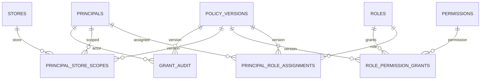

# Database Design v1.1 — Change Proposal
ID QP-DE-CP-001 | 2026-11-26 | FOR APPROVAL | Development NO-GO

Read with approved 14/15/16, architecture 12/13, readiness 17/18, metric baseline 19 and OD resolution 20 approved by QP-APR-007 (21), and permission matrix 22 approved by QP-APR-008 (23). This amendment candidate is not a replacement approved ERD or physical specification. Preserve retail grain, revenue arithmetic, historical snapshots, dataset targets and existing acceptance tests.

## Security registry candidate

The eight-object sketch below is historical. [Security Registry Data Model v1.0 (24)](24_SECURITY_REGISTRY_DATA_MODEL_V1_0.md) is the current 15-object review candidate, not approved DDL.
Propose separate security schema, outside the retail fact model. All objects below are logical candidates pending the Security Architect's permission matrix and identity ADR.

| Object | Candidate key and fields |
|---|---|
| principals | principal_id PK; issuer + subject unique; status; created_at |
| roles | role_id PK; role_code unique; status |
| permissions | permission_id PK; permission_code unique; status |
| policy_versions | policy_version_id PK; checksum, approved_by, effective_at; immutable published version |
| principal_role_assignments | assignment_id PK; principal_id and role_id FK; policy_version_id FK; valid_from, valid_until nullable; grant provenance |
| role_permission_grants | grant_id PK; role_id, permission_id, policy_version_id FK; effect; unique role/permission/version; deny-overrides-allow approved in 23 |
| principal_store_scopes | scope_id PK; principal_id, store_id, policy_version_id FK; validity window; explicit grants only |
| grant_audit | audit_id PK; actor principal FK, policy_version FK, action, target reference, redacted before/after, occurred_at, request_id; append-only |

Candidate principal-specific store grants are chosen for simplicity; role-scoped stores, direct grants and override semantics require separate review. Use half-open validity windows, no overlapping contradictory effective grants, no cascading deletion of audit history. Bind all applicable assignments, grants and scopes to the same active policy version; proposed atomic activation with immutable prior policy versions. Define session revocation and issuer lifecycle in identity ADR. Do not persist passwords or tokens in these objects. Security audit access is independent from business analytics.

## Physical authorization amendment
The v1.0 authorized_scope parameter is only a requested filter, never proof of entitlement. A raw merchandise event interface exposes component amounts and must not be granted to an execution principal whose authorization is limited to aggregates or units. Keep raw event assembly private; expose only approved metric-specific bounded operations with independently verified current identity, scope, capability and disclosure constraints. Exact routine signatures, ownership and SQL grants remain blocked pending security ADR.

Compare principal-bound PostgreSQL identity/RLS versus protected authorization routine. RLS alone does not prevent component or aggregation inference; validate role switching, ownership bypass, connection pooling and scope spoofing. A routine must resolve scope from independently protected identity, not arbitrary principal ID or GUC. No selection is approved. Retain current authorization when reading old business snapshots; never revive expired historical grants. Recheck before response and evidence retrieval. Separate identity administration, publication, migration, analytics and audit privileges.

## Additional database acceptance specifications
| ID | Scenario | Required outcome |
|---|---|---|
| DBSEC-01 | Requested stores outside effective grant | Deny entire explicit request, no unauthorized results |
| DBSEC-02 | Caller-supplied principal, role, GUC or scope | Cannot widen access |
| DBSEC-03 | Reused pooled connection across principals | No inherited authority or data |
| DBSEC-04 | Grant expired/revoked during analysis | Recheck and suppress unauthorized output |
| DBSEC-05 | Units-only principal requests revenue/component fields | No raw event or monetary disclosure |
| DBSEC-06 | M04-only principal requests gross/discount/refund bridge | Deny ungranted components; separately assess inference |
| DBSEC-07 | Admin without financial entitlement | No implicit analytics access |
| DBSEC-08 | Historic snapshot or evidence after access revoked | Current policy applies |
| DBSEC-09 | Direct base-table, DML, role escalation or privileged routine bypass attempt | Denied |
| DBSEC-10 | Missing coverage for permitted scope | No fabricated zero; unauthorized coverage metadata not disclosed |
| DBSEC-11 | Policy version activation or conflicting grants | Atomic consistent policy or fail closed |
| DBSEC-12 | Invalid/expired identity or grant audit tampering | Denied; sanitized audit retained |

Add synthetic identities for two disjoint store managers, units-only staff, M04-only analyst, admin without analytics, expired grant and no-chat principal. No real PII. Exact grants remain test candidates, not approved role policy. Keep separate from business dataset. All tests designed, not executed.

## Required follow-up
1. Owner approved OD-01–07 under QP-APR-007; BA/DB/Security independently verify the approved contracts.
2. Owner approved role/capability/metric/dependency/disclosure matrix (22/23); independent review and identity model approval remain pending.
3. Review registry specification (24) and complete nonforgeable DB authorization ADR; review indexes, transaction isolation, permissions, inference and threat assumptions.
4. Publish consolidated conceptual and physical v1.1 review candidates and obtain independent approvals; update PRD and readiness gates. No DDL, data generation, coding or test execution authorized.

No changes to approved v1.0 documents. Proposed fifth schema and expanded 15-object registry in document 24 are not yet approved. Existing 12 business/governance logical entities remain unchanged.
